<p align="center">
  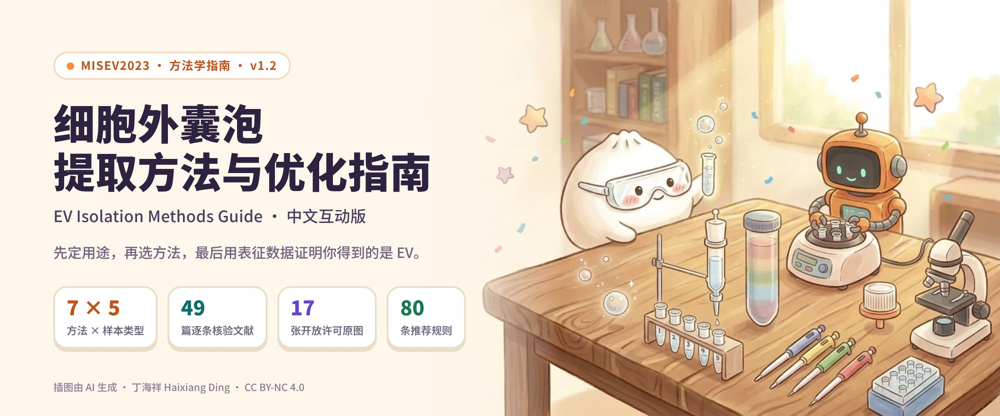
</p>

<h1 align="center">细胞外囊泡提取方法与优化指南 · EV Isolation Methods Guide</h1>

<p align="center">
  <strong>先定用途，再选方法，最后用表征数据证明你得到的是 EV。</strong><br>
  Decide the downstream use first, pick the method second, and prove with characterisation data that what you have is EVs.
</p>

<p align="center">
  七种主流提取方法的原理、参数与优化要点，按“样本 × 用途 × 优先指标”给出起点方案，依据 MISEV2023 的质控清单；49 篇文献逐条核验，17 张开放许可的文献原图。<br>
  An interactive Chinese guide to seven EV isolation methods, with a recommender, a MISEV2023 QC checklist, 49 verified references and 17 openly licensed literature figures.
</p>

<h3 align="center">
  <a href="https://tuanziding.github.io/ev-isolation-guide/">▶ 在线阅读 · Read online</a>
</h3>

<p align="center">
  <a href="https://aiai-academy.com/lessons/ev-isolation-guidev1.0.html">团子AI学院版本 · aiai-academy.com edition</a>
</p>

<p align="center">
  <a href="README.md">简体中文</a> · <a href="文档/英文说明v1.0.md">English</a>
</p>

<p align="center">
  <a href="https://github.com/TUANZIDING/ev-isolation-guide/actions"></a>
  
  <a href="https://creativecommons.org/licenses/by-nc/4.0/"></a>
  <a href="LICENSES/PolyForm-Noncommercial-1.0.0.md"></a>
  <a href="文档/图片说明v1.0.md"></a>
</p>

<p align="center">
  <code>7 种方法 × 5 类样本</code> · <code>方案推荐器 80 条规则</code> · <code>MISEV2023 质控清单</code> · <code>49 篇 PubMed + Crossref 核验</code> · <code>17 张文献原图</code> · <code>12 张 AI 示意图</code> · <code>纯静态 · 可离线 · 手机友好</code>
</p>

<p align="center">
  <a href="#use-cases">使用场景</a> ｜ <a href="#showcase">实际界面</a> ｜ <a href="#figures">图片</a> ｜ <a href="#quick-start">快速开始</a> ｜ <a href="#contents">仓库内容</a> ｜ <a href="#verification">如何核验</a> ｜ <a href="#capabilities">能力状态</a> ｜ <a href="#license">版权与许可</a>
</p>

<p align="center"><sub>封面由本仓库的 AI 插图与标题排版合成，不是实验数据，也不是网页截图。</sub></p>

> 🧪 核心原则：没有一种提取方法在所有样本和用途上都“最好”。各方法在回收率（得率）与特异性（纯度）之间位置不同，组合使用可提高特异性。所以先定下游用途，再选方法，最后用颗粒、形貌、蛋白标志物和纯度指标证明你得到的是 EV。

---

<a id="use-cases"></a>

## 用在哪里 · Use cases

| 你想做什么 | 可以怎样开始 |
| --- | --- |
| 第一次做 EV，不知道该用超离还是试剂盒 | 打开[方案推荐器](https://tuanziding.github.io/ev-isolation-guide/#rec)，选“样本 × 用途 × 优先指标”，得到起点路线和文献依据 |
| 血浆组学，担心脂蛋白污染 | 看[分样本要点](文档/方法/分样本要点v1.2.md)与 [SEC](文档/方法/3-尺寸排阻色谱v1.2.md)、[密度梯度](文档/方法/2-密度梯度离心v1.2.md)两份方法说明 |
| 写论文方法部分、准备审稿回复 | 逐项勾选[质控清单](文档/质控清单v1.2.md)（依据 MISEV2023），对照[常见坑与排查](文档/方法/常见坑与排查v1.2.md) |
| 带学生或组会讲 EV 方法学 | 投影[在线版](https://tuanziding.github.io/ev-isolation-guide/)：方法卡、横向对比、真实文献图都可点开放大 |
| 想知道 NTA、TEM、WB 的结果“正常”长什么样 | [真实文献图](https://tuanziding.github.io/ev-isolation-guide/#realfigs) 按仪器分组，可按样本类型筛选，每张图有中文“怎么读” |
| 在自己的脚本里复用推荐逻辑 | [`示例/推荐示例v1.0.py`](示例/推荐示例v1.0.py) 读取同一份 [`推荐规则v1.0.json`](示例/推荐规则v1.0.json) |

<a id="showcase"></a>

## 实际界面 · Showcase

[](https://tuanziding.github.io/ev-isolation-guide/)

<sub>首页（桌面 1440 px）：标题、核心原则、声明与“打开方案推荐器”。</sub>

| 方案推荐器 | 七种方法 | 质控清单 |
| --- | --- | --- |
| [](https://tuanziding.github.io/ev-isolation-guide/#rec) | [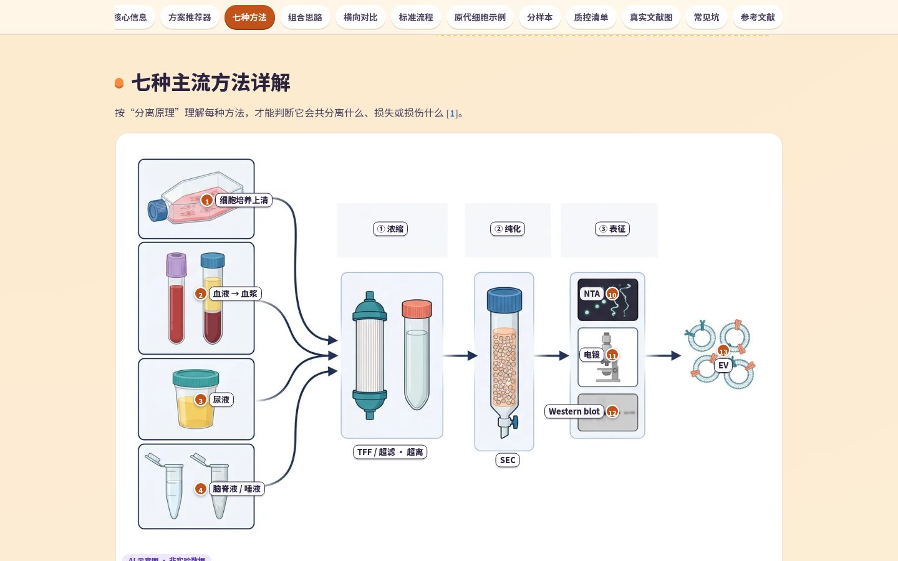](https://tuanziding.github.io/ev-isolation-guide/#methods) | [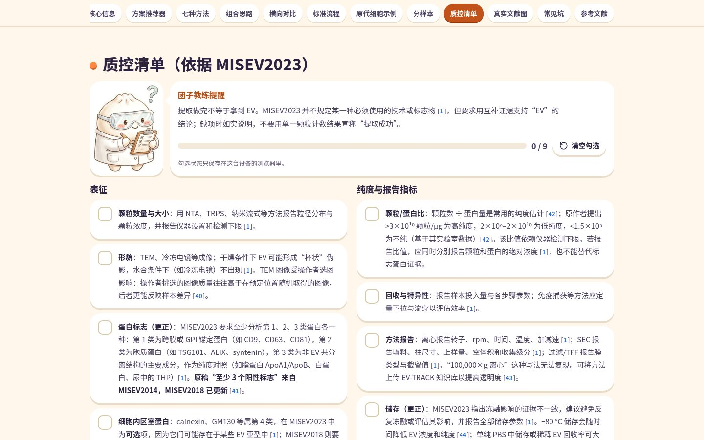](https://tuanziding.github.io/ev-isolation-guide/#qc) |

[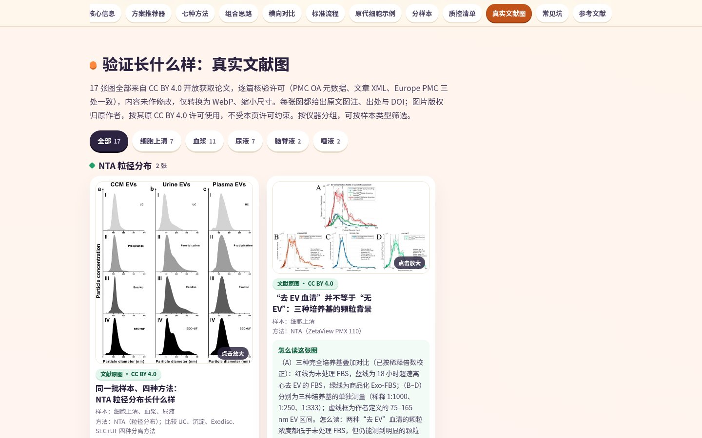](https://tuanziding.github.io/ev-isolation-guide/#realfigs)

<sub>真实文献图（桌面）：17 张 CC BY 4.0 原图按仪器分组，可按细胞上清、血浆、尿液、脑脊液、唾液筛选。</sub>

| 手机 · 首页 | 手机 · 方案推荐器 | 手机 · 真实文献图 |
| --- | --- | --- |
| [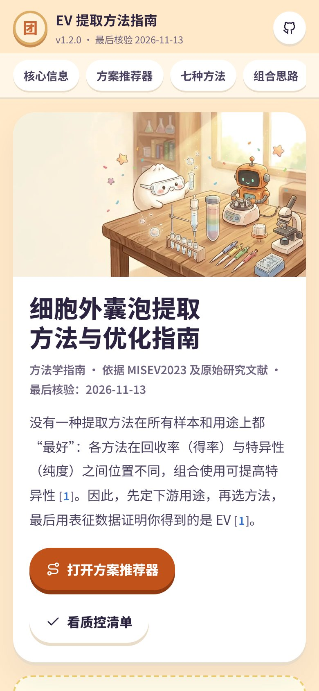](https://tuanziding.github.io/ev-isolation-guide/) | [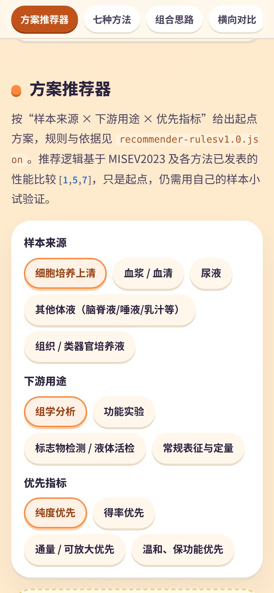](https://tuanziding.github.io/ev-isolation-guide/#rec) | [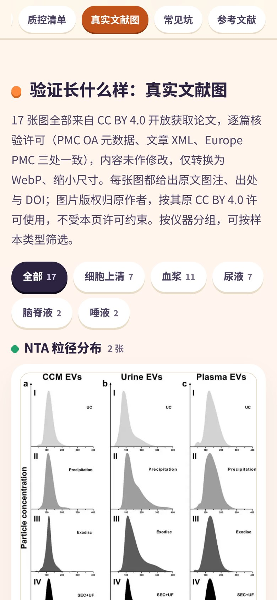](https://tuanziding.github.io/ev-isolation-guide/#realfigs) |

<sub>真实截图（Chromium 渲染 v1.2.0 网页；桌面 1440 px，手机 390 px）。交互效果请在线查看。</sub>

<a id="figures"></a>

## 图片 · Figures

### 文献原图（节选 6 / 17）· Reproduced literature figures

全部来自 CC BY 4.0 开放获取论文，逐篇在 PMC OA 元数据、文章 XML 与 Europe PMC 三处核对许可；内容未改，仅转为 WebP、缩小尺寸。版权归原作者，**仍按其原 CC BY 4.0 许可使用，不属于本仓库的非商业许可**。完整署名表：[`文档/图片说明v1.0.md`](文档/图片说明v1.0.md)。

<table>
<tr>
<td width="33%" valign="top"><a href="图片/文献原图/fig-method-grid-misev2023v1.0.webp">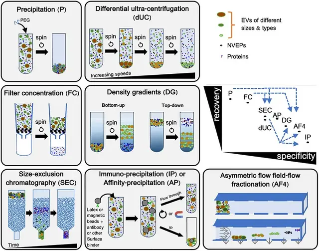</a><br><sub><b>文献原图 · CC BY 4.0</b><br>MISEV2023：各分离方法在“回收率 vs 特异性”坐标上的位置<br><i>Reproduced from Welsh et al., 2024, J Extracell Vesicles, FIGURE 2, <a href="https://creativecommons.org/licenses/by/4.0/">CC BY 4.0</a>, no changes. <a href="https://doi.org/10.1002/jev2.12404">DOI</a> · 文献 [1]</i></sub></td>
<td width="33%" valign="top"><a href="图片/文献原图/fig-nta-size-3samples-dong2020v1.0.webp">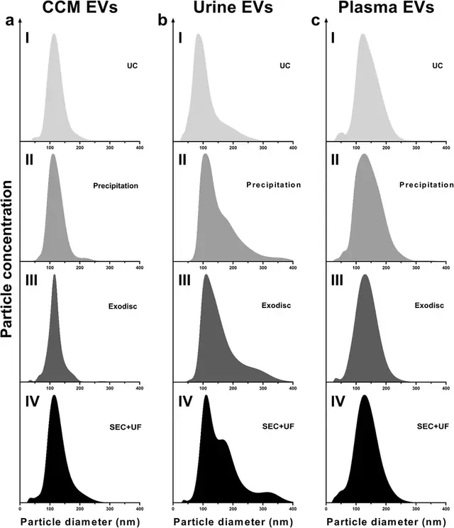</a><br><sub><b>文献原图 · CC BY 4.0</b><br>同一批样本、四种方法：NTA 粒径分布长什么样<br><i>Reproduced from Dong et al., 2020, J Extracell Vesicles, Figure 2, <a href="https://creativecommons.org/licenses/by/4.0/">CC BY 4.0</a>, no changes. <a href="https://doi.org/10.1002/jev2.12044">DOI</a> · 文献 [5]</i></sub></td>
<td width="33%" valign="top"><a href="图片/文献原图/fig-tem-3samples-dong2020v1.0.webp">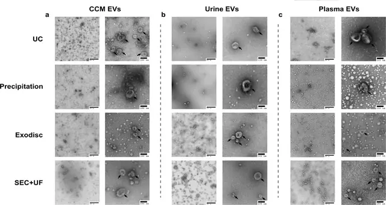</a><br><sub><b>文献原图 · CC BY 4.0</b><br>负染 TEM：三类样本、四种方法下的 EV 形貌<br><i>Reproduced from Dong et al., 2020, J Extracell Vesicles, Figure 5, <a href="https://creativecommons.org/licenses/by/4.0/">CC BY 4.0</a>, no changes. <a href="https://doi.org/10.1002/jev2.12044">DOI</a> · 文献 [5]</i></sub></td>
</tr>
<tr>
<td width="33%" valign="top"><a href="图片/文献原图/fig-sec-profile-plasma-karimi2018v1.0.webp">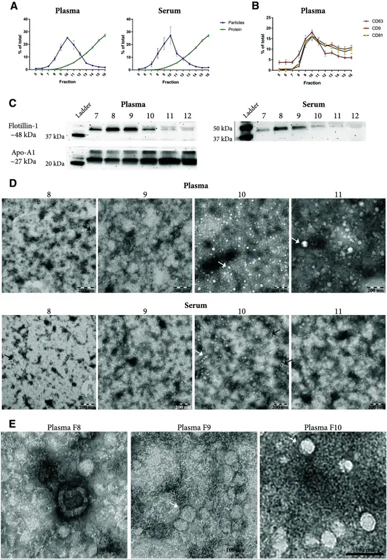</a><br><sub><b>文献原图 · CC BY 4.0</b><br>SEC 洗脱曲线：颗粒峰先出、蛋白峰后出——但 HDL 会跟着 EV 一起出来<br><i>Reproduced from Karimi et al., 2018, Cell Mol Life Sci, Fig. 2, <a href="https://creativecommons.org/licenses/by/4.0/">CC BY 4.0</a>, no changes. <a href="https://doi.org/10.1007/s00018-018-2773-4">DOI</a> · 文献 [17]</i></sub></td>
<td width="33%" valign="top"><a href="图片/文献原图/fig-cryoem-sec-peg-prospr-gamezvalero2016v1.0.webp">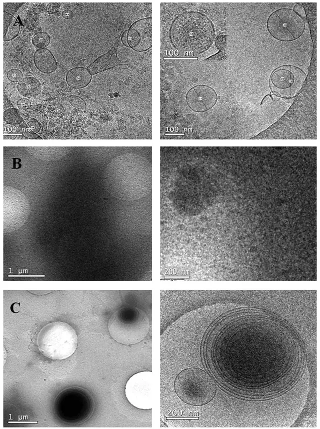</a><br><sub><b>文献原图 · CC BY 4.0</b><br>冷冻电镜对比：SEC 见到单个囊泡，PEG 沉淀只见到一片致密杂质<br><i>Reproduced from Gámez-Valero et al., 2016, Sci Rep, Figure 5, <a href="https://creativecommons.org/licenses/by/4.0/">CC BY 4.0</a>, no changes. <a href="https://doi.org/10.1038/srep33641">DOI</a> · 文献 [19]</i></sub></td>
<td width="33%" valign="top"><a href="图片/文献原图/fig-tff-vs-uc-busatto2018v1.0.webp">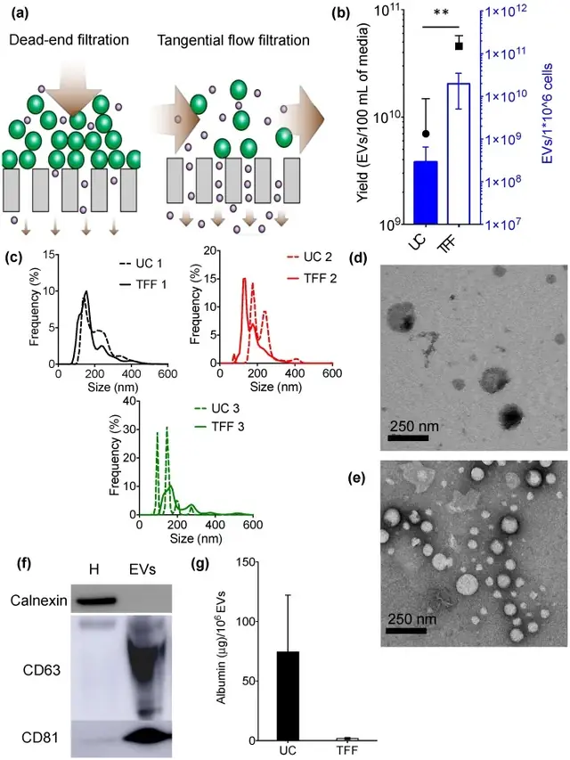</a><br><sub><b>文献原图 · CC BY 4.0</b><br>TFF 与超速离心正面对比：产量、粒径、形貌、标志物和白蛋白残留<br><i>Reproduced from Busatto et al., 2018, Cells, Figure 1, <a href="https://creativecommons.org/licenses/by/4.0/">CC BY 4.0</a>, no changes. <a href="https://doi.org/10.3390/cells7120273">DOI</a> · 文献 [4]</i></sub></td>
</tr>
</table>

### AI 示意图（节选 6 / 12）· AI-generated schematics

作者用 AI 生成的原理示意图，帮助理解装置与流程，**不是实验数据**；网页中另有逐张核对坐标的编号标注。

<table>
<tr>
<td width="33%" valign="top"><a href="图片/示意图/schem-overview-v1.0.webp">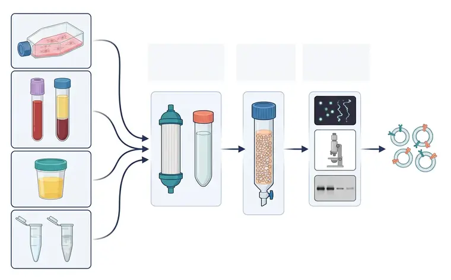</a><br><sub><b>AI 示意图 · 非实验数据</b><br>从样本到表征：EV 研究总流程</sub></td>
<td width="33%" valign="top"><a href="图片/示意图/schem-duc-v1.0.webp">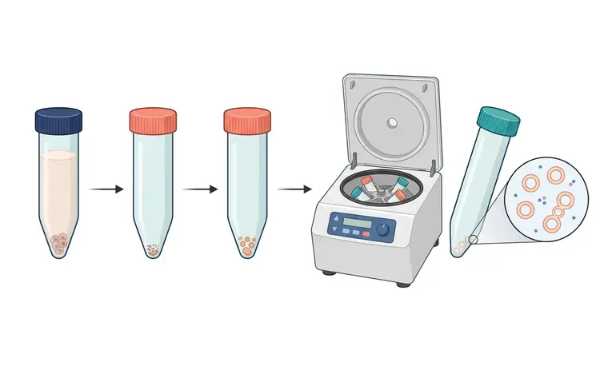</a><br><sub><b>AI 示意图 · 非实验数据</b><br>差速超速离心（dUC）</sub></td>
<td width="33%" valign="top"><a href="图片/示意图/schem-dguc-v1.0.webp">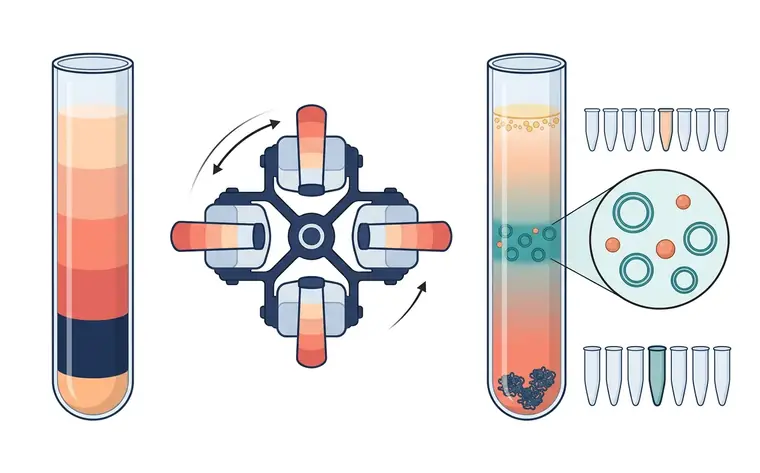</a><br><sub><b>AI 示意图 · 非实验数据</b><br>密度梯度离心（DGUC，碘克沙醇）</sub></td>
</tr>
<tr>
<td width="33%" valign="top"><a href="图片/示意图/schem-sec-v1.0.webp">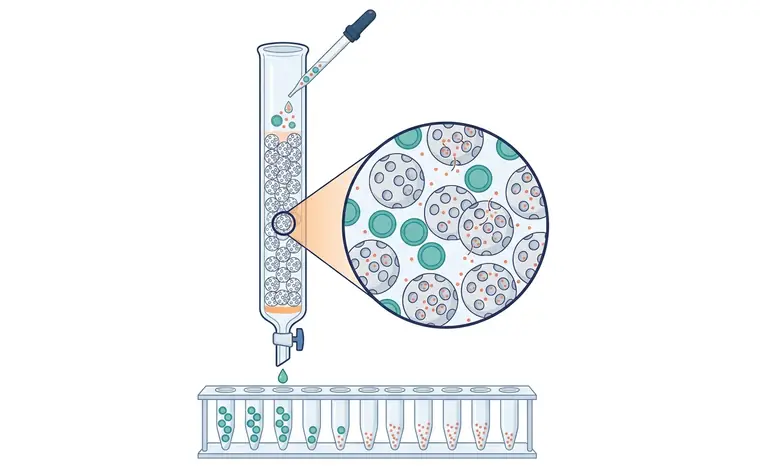</a><br><sub><b>AI 示意图 · 非实验数据</b><br>尺寸排阻色谱（SEC）</sub></td>
<td width="33%" valign="top"><a href="图片/示意图/schem-tff-v1.0.webp">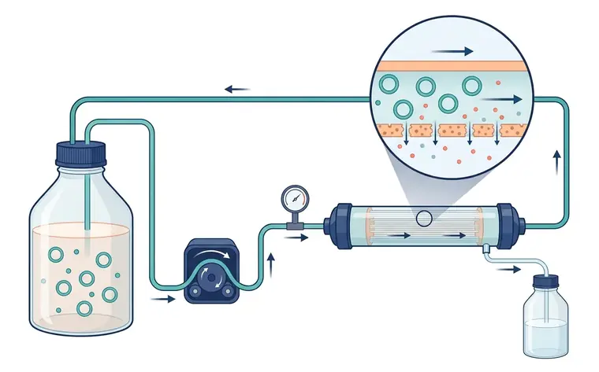</a><br><sub><b>AI 示意图 · 非实验数据</b><br>切向流过滤（TFF）</sub></td>
<td width="33%" valign="top"><a href="图片/示意图/schem-nta-v1.0.webp">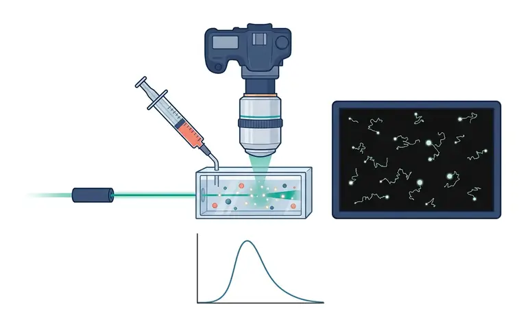</a><br><sub><b>AI 示意图 · 非实验数据</b><br>纳米颗粒追踪分析（NTA）</sub></td>
</tr>
</table>

<sub>两处缺口：exomere 的 AF4 洗脱曲线（Zhang 2018 [30]）和尿液 DTT 处理前后对比（Fernández-Llama 2010 [38]）没有找到开放许可的原图，未转载，网页中给出原文链接。</sub>

<a id="quick-start"></a>

## 先用起来 · Quick start

1. 手机或电脑浏览器打开 **[在线版](https://tuanziding.github.io/ev-isolation-guide/)**；iPhone 可点“分享 → 添加到主屏幕”。
2. 想打印或存 PDF：页面底部“打印 / 存为 PDF”，或直接用 Markdown 版：[七种方法](文档/方法/) · [质控清单](文档/质控清单v1.2.md)。
3. 离线使用：下载整个仓库（Code → Download ZIP），双击根目录 `index.html`。

```sh
git clone https://github.com/TUANZIDING/ev-isolation-guide.git
cd ev-isolation-guide && python3 -m http.server 8000      # 打开 http://localhost:8000
python3 示例/推荐示例v1.0.py plasma omics purity           # 命令行查起点方案
python3 验证/项目检查v1.0.py                                # 离线检查链接、引用、图片许可与许可文字
```

<a id="contents"></a>

## 仓库内容 · Contents

```text
ev-isolation-guide/
├── index.html + assets/        互动网页（系统字体、无外部 CDN；assets/data/ 为推荐规则与文献数据）
├── 文档/
│   ├── 指南正文v1.2.md         唯一事实来源；网页与下列 Markdown 都由它生成
│   ├── 方法/                   7 份方法说明 + 组合思路、横向对比、标准流程、原代细胞示例、分样本要点、常见坑
│   ├── 质控清单v1.2.md         依据 MISEV2023 的可勾选清单
│   ├── 图片说明v1.0.md         图片分类、许可与逐张署名表
│   ├── 英文说明v1.0.md         English guide
│   ├── 主图/                   封面
│   └── 截图/                   真实界面截图（桌面 + 手机）
├── 图片/
│   ├── 文献原图/               17 张 CC BY 4.0 原图 + 文献原图说明v1.0.json（出处、原文图注、许可核验记录）
│   └── 示意图/                 12 张 AI 示意图 + 示意图标注v1.1.json（标注坐标）
├── 示例/                       推荐规则v1.0.json（80 条）· 推荐示例v1.0.py · 推荐示例v1.0.md
├── 验证/                       项目检查v1.0.py · 参考文献v1.1.json / .bib · 陈述核验v1.0.json · 审核报告v1.0.md
├── 工具/                       构建网页v1.2.py · 构建文档v1.2.py · 网页检查v1.2.py（无头浏览器）
├── LICENSE · LICENSES/          许可全文
└── CITATION.cff
```

| 七种方法 | Markdown |
| --- | --- |
| 差速超速离心（dUC） | [1-差速超速离心v1.2.md](文档/方法/1-差速超速离心v1.2.md) |
| 密度梯度离心（DGUC） | [2-密度梯度离心v1.2.md](文档/方法/2-密度梯度离心v1.2.md) |
| 尺寸排阻色谱（SEC） | [3-尺寸排阻色谱v1.2.md](文档/方法/3-尺寸排阻色谱v1.2.md) |
| 超滤与切向流过滤（UF / TFF） | [4-超滤与切向流过滤v1.2.md](文档/方法/4-超滤与切向流过滤v1.2.md) |
| 聚合物沉淀（PEG 等） | [5-聚合物沉淀v1.2.md](文档/方法/5-聚合物沉淀v1.2.md) |
| 免疫亲和捕获 | [6-免疫亲和捕获v1.2.md](文档/方法/6-免疫亲和捕获v1.2.md) |
| 微流控与非对称流场流分离（AF4） | [7-微流控与流场流分离v1.2.md](文档/方法/7-微流控与流场流分离v1.2.md) |

<a id="verification"></a>

## 陈述如何核验 · How the claims were verified

1. 从原稿逐条拆出事实性陈述，共 106 条，记录在 [`验证/陈述核验v1.0.json`](验证/陈述核验v1.0.json)。
2. 每条陈述用 PubMed E-utilities 检索原始文献，读 PMC 开放全文或摘要，记录支持它的原文引语。
3. 用 Crossref API 核对每条文献的 DOI、卷、页、年份和第一作者：v1.0 的 45 条全部通过（OK 45 / MISMATCH 0 / FABRICATED 0）；v1.1 新增的 [46]–[49] 同样核验，只作为转载图片的出处，不支撑正文陈述。35 篇读过全文，10 篇只核对摘要，这 10 篇只用来支撑摘要里明确写到的内容（名单见 [`验证/审核报告v1.0.md`](验证/审核报告v1.0.md)）。
4. 分级结果：有原文支持 44 条；方向正确但表述过度或数字不准、已改写 52 条（其中 14 条为实质性纠错）；无可核验文献 10 条，已删除或保留并标注。
5. 网页中凡标注【实验室惯例】、【估算】或【作者判断】的内容，没有直接的文献测定值支持；方法卡上的评分点数是“定性共识”，不是测量值。

每个事实句后的 [n] 都链接到参考文献表，表中每条都有 DOI 与 PubMed 链接。`验证/项目检查v1.0.py` 每次推送自动检查：49 条文献编号与网页引用一一对应、17 张原图都在署名表中且许可为 CC BY 4.0、本地链接与图片存在、旧稿禁用措辞、许可文字一致。

<a id="capabilities"></a>

## 当前做到哪一步 · Capability status

| 状态 | 内容 | 实际边界 |
| --- | --- | --- |
| 已完成 | 互动网页、方案推荐器（80 条规则）、七种方法卡、横向对比、质控清单、真实文献图灯箱与样本筛选 | 推荐结果是起点方案，需本实验室小试验证 |
| 已核对 | 49 篇参考文献（PubMed + Crossref）、106 条陈述的证据分级、17 张图的许可 | 10 篇只核对摘要；参数以仪器与产品说明书为准 |
| 已检查 | 390 / 1440 px 显示、无 JS 报错、无失效图片、291 处引用全部可跳转 | 质控勾选只保存在本机浏览器 |
| 计划中 | 英文版网页、更多样本类型（乳汁、组织）的开放许可原图 | — |

## 如何引用 · How to cite

请同时引用本指南和你实际依据的原始文献。GitHub 会识别根目录的 [`CITATION.cff`](CITATION.cff)（页面右侧 “Cite this repository”）。

> Ding H. 细胞外囊泡提取方法与优化指南（Extracellular Vesicle Isolation Methods: An Interactive Chinese Guide）. Version 1.2.0. 2026-11-13. https://github.com/TUANZIDING/ev-isolation-guide

## 声明 · Disclaimer

本指南为方法学参考与文献综述，不构成针对任何具体课题的实验方案或结论。文中参数为已发表研究或国际细胞外囊泡学会（ISEV）指南中的报告值或常见范围，具体数值以所用仪器、转子和商品化产品说明书为准，正式实验前应在本实验室样本上小试验证。

<a id="license"></a>

## 版权与许可 · License

本仓库仅供**非商业**学习、教学与科研使用 / For **non-commercial** use only.

| 部分 | 范围 | 许可 |
| --- | --- | --- |
| 作者原创内容 | `文档/`、`示例/` 的规则与说明、`验证/` 的核验记录、`assets/data/`、`图片/示意图/`（AI 示意图）、团子插图、封面与截图、网页与本 README 的文字 | [CC BY-NC 4.0](https://creativecommons.org/licenses/by-nc/4.0/)（署名—非商业性使用），全文见 [`LICENSES/CC-BY-NC-4.0.txt`](LICENSES/CC-BY-NC-4.0.txt) |
| 代码 | `index.html` 的页面结构与脚本、`assets/*.css`、`assets/*.js`、`工具/`、`验证/*.py`、`示例/*.py`、`.github/` | [PolyForm Noncommercial 1.0.0](https://polyformproject.org/licenses/noncommercial/1.0.0/)，全文见 [`LICENSES/PolyForm-Noncommercial-1.0.0.md`](LICENSES/PolyForm-Noncommercial-1.0.0.md) |
| 第三方文献原图 | `图片/文献原图/fig-*.webp`（17 张） | **不属于**本仓库许可：版权归原作者，仍按各自原论文的 [CC BY 4.0](https://creativecommons.org/licenses/by/4.0/)；再使用时按 [`文档/图片说明v1.0.md`](文档/图片说明v1.0.md) 的署名语注明出处 |

团子插图与 AI 示意图仅作示意，不代表真实实验装置或实验数据。参考文献条目只是书目信息，本仓库不分发被引论文本身。许可总说明见 [`LICENSE`](LICENSE)。

<a id="commercial-use"></a>

### 商业使用 · Commercial use

**商业用途需事先联系作者获得授权合作。** 包括但不限于：收费课程或培训、商业出版物或网站、产品宣传与销售材料、付费数据库。<br>
**Commercial use requires prior permission; contact the author.** This includes paid courses or training, commercial publications or websites, marketing material and paid databases.

👉 [联系作者 / Contact the author](https://tuanziding.github.io/#contact)

<p align="center"><sub>先定用途，再选方法 · 丁海祥 Haixiang Ding · <a href="https://tuanziding.github.io/#research">个人主页</a></sub></p>
