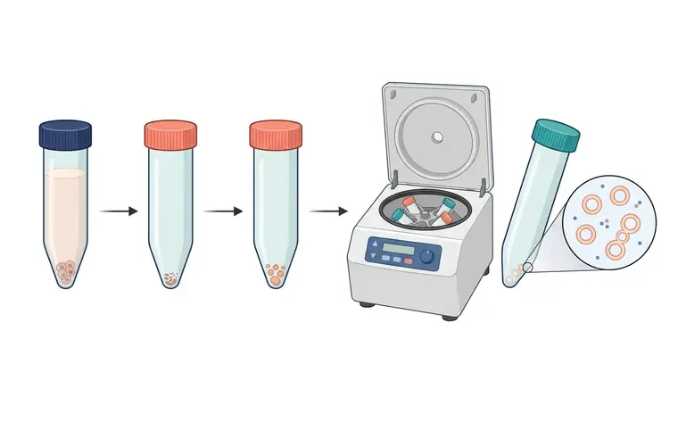
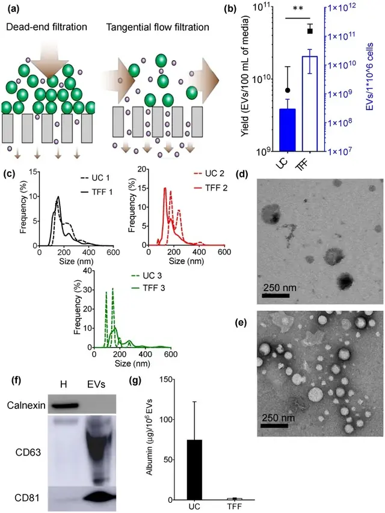
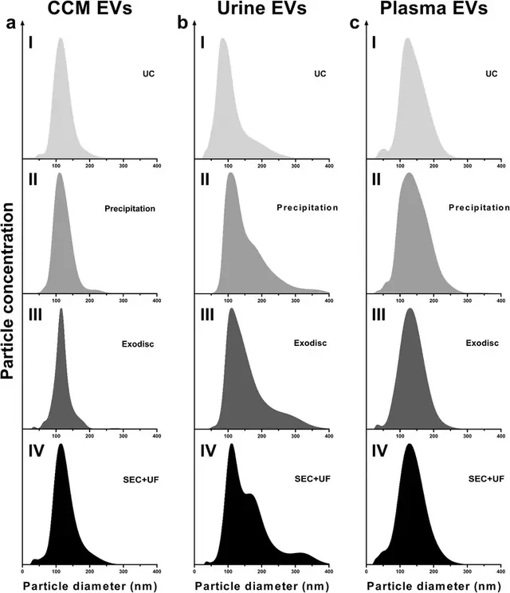

# 方法 1：差速超速离心（dUC）· 最常用的参照方法

> 摘自 [`docs/content-zhv1.1.md`](../docs/content-zhv1.1.md)（v1.1.0，最后核验 2026-11-13），文字逐字保留，[n] 编号与 [`references/referencesv1.1.json`](../references/referencesv1.1.json) 一致。在线互动版：<https://tuanziding.github.io/ev-isolation-guide/>
>
> **声明**：本页为方法学参考与文献综述，不构成针对任何具体课题的实验方案或结论。文中参数为已发表研究或国际细胞外囊泡学会（ISEV）指南中的报告值或常见范围，具体数值以所用仪器、转子和商品化产品说明书为准，正式实验前应在本实验室样本上小试验证。用于正式研究时，提取方案与质控标准建议预先写入研究方案或预注册。凡标注“【实验室惯例】”或“【估算】”的内容，没有直接的文献测定值支持，仅供参考。

按“分离原理”理解每种方法，才能判断它会共分离什么、损失或损伤什么 [1]。

**原理**：按沉降系数逐级离心——低速去细胞和碎片，中速去较大颗粒，高速沉淀较小 EV；沉降系数与颗粒大小和密度相关 [1]。

**典型参数**：最常引用的方案为 300×g 10 min → 2,000×g 10 min → 10,000×g 30 min → 100,000×g 70 min，沉淀重悬后再以 100,000×g 洗涤一次 [8,9]。文献中沉淀小 EV 的条件通常为约 100,000–200,000×g、45–150 min [1]。必须报告转子型号、转速（rpm）、时间、温度及加减速设置，以便计算校正 k 因子并换算到其他转子 [1]；转子类型、g 值和离心时间都会显著影响得率与纯度 [9,10]。

**优点**：不需额外试剂，是使用最广泛的方法（2015 年 ISEV 调查中 81% 受访者使用），因而文献可比性最好 [6]。

**局限**：高速、长时间离心会共分离沉降系数相近的非囊泡颗粒，并可能诱导 EV 聚集 [1,11]。回收率偏低：一项用纳米流式评估血浆的研究估算，单次 100,000×g 2 h 回收约 40%，两次超离约 16% [12]；重复超离会降低得率 [13]。（原稿“约 5%–40%”的下限无文献支持，已改写。）

**优化要点**：0.22 µm 过滤可去除较大颗粒，但也会把大 EV 截留在滤器上，并需注意挤压造成的人为颗粒，须在方法中声明 [1]。黏性体液中颗粒回收率与黏度成反比，应考虑先稀释再超离 [14]。沉淀轻柔重悬、避免反复吹打【实验室惯例】。

**定性评分**（领域定性共识，见“横向对比”说明）：纯度 3/5 · 得率 3/5 · 通量 2/5。

## 相关图片

点击缩略图查看原图。标“AI 示意图 · 非实验数据”的是帮助理解原理的 AI 生成示意图；标“文献原图 · CC BY 4.0”的转载自原论文，版权归原作者，按其原 CC BY 4.0 许可使用（见 [`FIGURES-LICENSES.md`](../FIGURES-LICENSES.md)），不属于本仓库的许可范围。

**差速超速离心（dUC）**（AI 示意图 · 非实验数据）

1. 300×g 去细胞；2. 2,000×g 去碎片；3. 10,000×g 去较大颗粒；4. 100,000×g 超速离心（固定角转子）；5. EV 沉淀（管外侧底壁）；6. 囊泡沉淀，可见聚集

逐级离心：低速沉淀细胞，中速沉淀碎片与较大颗粒，上清最后在超速离心机的固定角转子中高速离心；小 EV 沉淀位于倾斜管的外侧底壁。放大圈示脂双层囊泡沉淀，夹杂少量蛋白，且有囊泡相互粘连（提示高速离心可诱导聚集）。

**TFF 与超速离心正面对比：产量、粒径、形貌、标志物和白蛋白残留**（文献原图 · CC BY 4.0）

怎么读：（a）死端过滤与切向流过滤的原理示意：TFF 液流平行于膜面，减少滤膜堵塞；（b）EV 产量（TFF 显著高于 UC）；（c）三次重复的粒径分布（虚线 UC，实线 TFF）；（d、e）UC 与 TFF 所得 EV 的 TEM；（f）TFF 样品 Western blot：EV 中检出 CD63、CD81，不含细胞内标志 calnexin（H 为细胞匀浆对照）；（g）每 10⁶ 个 EV 的白蛋白残留，TFF 低于 UC。怎么读：一张合格的方法比较图应同时给出产量、粒径、形貌、阳性/阴性标志物和一个“污染物”指标（这里是白蛋白），而不是只比颗粒数。

> Reproduced from Busatto S, Vilanilam G, Ticer T, et al., 2018, *Cells* Figure 1, [CC BY 4.0](https://creativecommons.org/licenses/by/4.0/), no changes. DOI: [10.3390/cells7120273](https://doi.org/10.3390/cells7120273) · [PMC6315734](https://pmc.ncbi.nlm.nih.gov/articles/PMC6315734/) · 文献 [4]

**同一批样本、四种方法：NTA 粒径分布长什么样**（文献原图 · CC BY 4.0）

怎么读：这张图把细胞培养上清、尿液、血浆三类样本分别用超速离心（UC）、沉淀、Exodisc、SEC+超滤（SEC+UF）分离后，用 NTA 测得的粒径分布并排放在一起（每列一种样本，每行一种方法）。怎么读：横轴是颗粒直径（nm），纵轴是颗粒浓度；作者把每张图的峰高都调到量程的 95%，所以只能比较“形状”（峰位置、峰宽、拖尾），不能直接比较高低。一般认为小 EV 制备的主峰落在约 100–150 nm 附近且拖尾有限；尿液列可见部分方法出现更宽的肩峰和拖尾。注意：NTA 只数“颗粒”，蛋白聚集体、脂蛋白同样会被计入，单看粒径分布不能证明纯度，需与蛋白定量、Western blot 合看。

> Reproduced from Dong L, Zieren RC, Horie K, et al., 2020, *J Extracell Vesicles* Figure 2, [CC BY 4.0](https://creativecommons.org/licenses/by/4.0/), no changes. DOI: [10.1002/jev2.12044](https://doi.org/10.1002/jev2.12044) · [PMC7810129](https://pmc.ncbi.nlm.nih.gov/articles/PMC7810129/) · 文献 [5]

## 本文引用的参考文献

[1] Welsh JA, Goberdhan DCI, O'Driscoll L, Buzas EI, Blenkiron C, Bussolati B, et al. Minimal information for studies of extracellular vesicles (MISEV2023): From basic to advanced approaches. J Extracell Vesicles. 2024;13:e12404. doi:[10.1002/jev2.12404](https://doi.org/10.1002/jev2.12404). PMID:[38326288](https://pubmed.ncbi.nlm.nih.gov/38326288/); [PMC10850029](https://pmc.ncbi.nlm.nih.gov/articles/PMC10850029/).

[4] Busatto S, Vilanilam G, Ticer T, Lin WL, Dickson DW, Shapiro S, et al. Tangential Flow Filtration for Highly Efficient Concentration of Extracellular Vesicles from Large Volumes of Fluid. Cells. 2018;7:273. doi:[10.3390/cells7120273](https://doi.org/10.3390/cells7120273). PMID:[30558352](https://pubmed.ncbi.nlm.nih.gov/30558352/); [PMC6315734](https://pmc.ncbi.nlm.nih.gov/articles/PMC6315734/).

[5] Dong L, Zieren RC, Horie K, Kim CJ, Mallick E, Jing Y, et al. Comprehensive evaluation of methods for small extracellular vesicles separation from human plasma, urine and cell culture medium. J Extracell Vesicles. 2020;10:e12044. doi:[10.1002/jev2.12044](https://doi.org/10.1002/jev2.12044). PMID:[33489012](https://pubmed.ncbi.nlm.nih.gov/33489012/); [PMC7810129](https://pmc.ncbi.nlm.nih.gov/articles/PMC7810129/).

[6] Gardiner C, Di Vizio D, Sahoo S, Théry C, Witwer KW, Wauben M, et al. Techniques used for the isolation and characterization of extracellular vesicles: results of a worldwide survey. J Extracell Vesicles. 2016;5:32945. doi:[10.3402/jev.v5.32945](https://doi.org/10.3402/jev.v5.32945). PMID:[27802845](https://pubmed.ncbi.nlm.nih.gov/27802845/); [PMC5090131](https://pmc.ncbi.nlm.nih.gov/articles/PMC5090131/).

[8] Théry C, Amigorena S, Raposo G, Clayton A. Isolation and characterization of exosomes from cell culture supernatants and biological fluids. Curr Protoc Cell Biol. 2006;30:Unit 3.22. doi:[10.1002/0471143030.cb0322s30](https://doi.org/10.1002/0471143030.cb0322s30). PMID:[18228490](https://pubmed.ncbi.nlm.nih.gov/18228490/).

[9] Livshits MA, Khomyakova E, Evtushenko EG, Lazarev VN, Kulemin NA, Semina SE, et al. Isolation of exosomes by differential centrifugation: Theoretical analysis of a commonly used protocol. Sci Rep. 2015;5:17319. doi:[10.1038/srep17319](https://doi.org/10.1038/srep17319). PMID:[26616523](https://pubmed.ncbi.nlm.nih.gov/26616523/); [PMC4663484](https://pmc.ncbi.nlm.nih.gov/articles/PMC4663484/).

[10] Cvjetkovic A, Lötvall J, Lässer C. The influence of rotor type and centrifugation time on the yield and purity of extracellular vesicles. J Extracell Vesicles. 2014;3:23111. doi:[10.3402/jev.v3.23111](https://doi.org/10.3402/jev.v3.23111). PMID:[24678386](https://pubmed.ncbi.nlm.nih.gov/24678386/); [PMC3967015](https://pmc.ncbi.nlm.nih.gov/articles/PMC3967015/).

[11] Linares R, Tan S, Gounou C, Arraud N, Brisson AR. High-speed centrifugation induces aggregation of extracellular vesicles. J Extracell Vesicles. 2015;4:29509. doi:[10.3402/jev.v4.29509](https://doi.org/10.3402/jev.v4.29509). PMID:[26700615](https://pubmed.ncbi.nlm.nih.gov/26700615/); [PMC4689953](https://pmc.ncbi.nlm.nih.gov/articles/PMC4689953/).

[12] Tian Y, Gong M, Hu Y, Liu H, Zhang W, Zhang M, et al. Quality and efficiency assessment of six extracellular vesicle isolation methods by nano-flow cytometry. J Extracell Vesicles. 2020;9:1697028. doi:[10.1080/20013078.2019.1697028](https://doi.org/10.1080/20013078.2019.1697028). PMID:[31839906](https://pubmed.ncbi.nlm.nih.gov/31839906/); [PMC6896440](https://pmc.ncbi.nlm.nih.gov/articles/PMC6896440/).

[13] Lobb RJ, Becker M, Wen SW, Wong CS, Wiegmans AP, Leimgruber A, et al. Optimized exosome isolation protocol for cell culture supernatant and human plasma. J Extracell Vesicles. 2015;4:27031. doi:[10.3402/jev.v4.27031](https://doi.org/10.3402/jev.v4.27031). PMID:[26194179](https://pubmed.ncbi.nlm.nih.gov/26194179/); [PMC4507751](https://pmc.ncbi.nlm.nih.gov/articles/PMC4507751/).

[14] Momen-Heravi F, Balaj L, Alian S, Trachtenberg AJ, Hochberg FH, Skog J, et al. Impact of biofluid viscosity on size and sedimentation efficiency of the isolated microvesicles. Front Physiol. 2012;3:162. doi:[10.3389/fphys.2012.00162](https://doi.org/10.3389/fphys.2012.00162). PMID:[22661955](https://pubmed.ncbi.nlm.nih.gov/22661955/); [PMC3362089](https://pmc.ncbi.nlm.nih.gov/articles/PMC3362089/).
