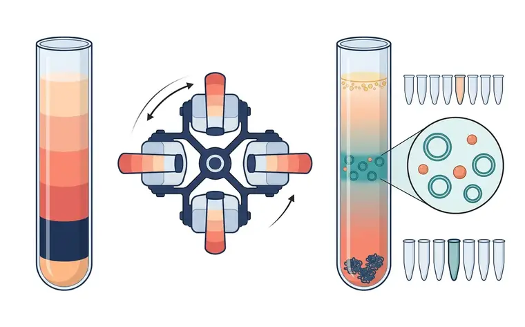
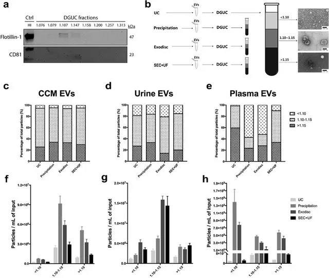
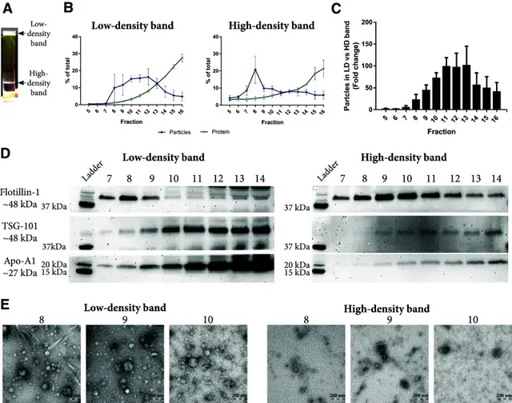

# 方法 2：密度梯度离心（DGUC）· 纯度上限高

> 摘自 [`docs/content-zhv1.1.md`](../docs/content-zhv1.1.md)（v1.1.0，最后核验 2026-11-13），文字逐字保留，[n] 编号与 [`references/referencesv1.1.json`](../references/referencesv1.1.json) 一致。在线互动版：<https://tuanziding.github.io/ev-isolation-guide/>
>
> **声明**：本页为方法学参考与文献综述，不构成针对任何具体课题的实验方案或结论。文中参数为已发表研究或国际细胞外囊泡学会（ISEV）指南中的报告值或常见范围，具体数值以所用仪器、转子和商品化产品说明书为准，正式实验前应在本实验室样本上小试验证。用于正式研究时，提取方案与质控标准建议预先写入研究方案或预注册。凡标注“【实验室惯例】”或“【估算】”的内容，没有直接的文献测定值支持，仅供参考。

按“分离原理”理解每种方法，才能判断它会共分离什么、损失或损伤什么 [1]。

**原理**：在碘克沙醇（OptiPrep）或蔗糖梯度中按浮力密度分离 [1]。EV 的浮力密度范围常引用为约 1.08–1.19 g/mL [7,9]；在碘克沙醇梯度中实测的 EV 富集段例如约 1.094 g/mL [2] 或 1.10–1.15 g/mL [5]（不同梯度介质与样本有差异）。DGUC 能把 EV 与可溶性蛋白及非囊泡组分分开 [2,15]，并与较低密度的脂蛋白（VLDL、LDL、乳糜微粒）分开；但 **HDL 的密度（1.063–1.21 g/mL）与 EV 重叠，单靠密度梯度无法去除** [1,16]。

**典型参数**：常在 dUC 粗提后上样。例如碘克沙醇梯度 100,000×g、4 °C 离心 18 h [2]；分段收集后用吸光度标准曲线或折光率确定各段密度 [1,2]。

**优点**：比单纯超离和沉淀法纯度更高，适合组学与标志物研究 [2,15]。与蔗糖不同，碘克沙醇在各密度下都可配成等渗溶液，更好地保持囊泡大小 [2]。

**局限**：耗时长、操作门槛高；下游分析前通常必须去除梯度介质（稀释后再超离或用 SEC），且梯度加洗涤后的回收率相对较低 [1]。

**优化要点**：优先选碘克沙醇 [2]；收集后换液去除介质 [1]；血液样本若需同时去除 HDL，与 SEC 组合 [1,17]。

**定性评分**（定性共识，非测量值）：纯度 5/5 · 得率 2/5 · 通量 1/5。

## 相关图片

点击缩略图查看原图。标“AI 示意图 · 非实验数据”的是帮助理解原理的 AI 生成示意图；标“文献原图 · CC BY 4.0”的转载自原论文，版权归原作者，按其原 CC BY 4.0 许可使用（见 [`FIGURES-LICENSES.md`](../FIGURES-LICENSES.md)），不属于本仓库的许可范围。

**密度梯度离心（DGUC，碘克沙醇）**（AI 示意图 · 非实验数据）

1. 离心前：碘克沙醇分层梯度；2. 水平（甩平）转子；3. 低密度脂蛋白（顶部）；4. EV 带（约 1.10 g/mL 段）；5. 蛋白聚集（底部）；6. EV 与 HDL 样颗粒共存；7. 分段收集级分

左：离心前的分层碘克沙醇梯度；中：水平转子（吊篮甩平）；右：长时间离心后，低密度脂蛋白浮在顶部，EV 在梯度中段形成条带，致密蛋白聚集体沉于底部；旁边为自上而下分段收集的级分，中段级分被标出。放大圈示 EV 带中仍混有大小相近的小颗粒，对应 HDL 与 EV 密度重叠、单靠密度无法去除。

**密度梯度分级：EV 在哪一层，脂蛋白和蛋白聚集体在哪一层**（文献原图 · CC BY 4.0）

怎么读：（a）血浆经 UC 后再做密度梯度离心，8 个组分（顶部标注密度 1.076–1.313 g/mL）等体积上样，检测 flotillin-1 和 CD81；（b）作者把组分分成低（<1.10）、中（1.10–1.15）、高（>1.15）三组并配 TEM：低密度组见脂质/脂蛋白等非 EV 颗粒，中密度组见杯状 EV，高密度组见蛋白聚集体等；（c–h）各方法制备物在三组中的颗粒比例与浓度。怎么读：EV 标志物应集中在约 1.10–1.15 g/mL 的中间组分；若大量颗粒落在低密度组（血浆中提示脂蛋白）或高密度组（蛋白聚集体），说明前一步分离的特异性不足。

> Reproduced from Dong L, Zieren RC, Horie K, et al., 2020, *J Extracell Vesicles* Figure 9, [CC BY 4.0](https://creativecommons.org/licenses/by/4.0/), no changes. DOI: [10.1002/jev2.12044](https://doi.org/10.1002/jev2.12044) · [PMC7810129](https://pmc.ncbi.nlm.nih.gov/articles/PMC7810129/) · 文献 [5]

**血浆“两步法”：密度垫 + SEC 把 EV 与脂蛋白分开**（文献原图 · CC BY 4.0）

怎么读：（a）血浆加在碘克沙醇密度垫上超速离心后出现两条带：低密度带（<1.025 g/cm³）与高密度带（约 1.06–1.16 g/cm³）；（b）两条带分别再过 SEC，测各组分颗粒与蛋白；（c）低密度带与高密度带的颗粒数倍数比较；（d）Western blot：EV 标志 flotillin-1、TSG-101 与 HDL 标志 Apo-A1 在两条带各组分中的分布；（e）负染 TEM。怎么读：原文用这一组合来把 EV 从脂蛋白和血浆蛋白中分出来；判读时看高密度带的 SEC 组分中 TSG-101 等 EV 标志物是否保留、Apo-A1 等脂蛋白信号是否相对减少——这比单用一种方法更接近“干净”的血浆 EV。具体结论请以原文结果部分为准。

> Reproduced from Karimi N, Cvjetkovic A, Jang SC, et al., 2018, *Cell Mol Life Sci* Fig. 4, [CC BY 4.0](https://creativecommons.org/licenses/by/4.0/), no changes. DOI: [10.1007/s00018-018-2773-4](https://doi.org/10.1007/s00018-018-2773-4) · [PMC6021463](https://pmc.ncbi.nlm.nih.gov/articles/PMC6021463/) · 文献 [17]

## 本文引用的参考文献

[1] Welsh JA, Goberdhan DCI, O'Driscoll L, Buzas EI, Blenkiron C, Bussolati B, et al. Minimal information for studies of extracellular vesicles (MISEV2023): From basic to advanced approaches. J Extracell Vesicles. 2024;13:e12404. doi:[10.1002/jev2.12404](https://doi.org/10.1002/jev2.12404). PMID:[38326288](https://pubmed.ncbi.nlm.nih.gov/38326288/); [PMC10850029](https://pmc.ncbi.nlm.nih.gov/articles/PMC10850029/).

[2] Van Deun J, Mestdagh P, Sormunen R, Cocquyt V, Vermaelen K, Vandesompele J, et al. The impact of disparate isolation methods for extracellular vesicles on downstream RNA profiling. J Extracell Vesicles. 2014;3:24858. doi:[10.3402/jev.v3.24858](https://doi.org/10.3402/jev.v3.24858). PMID:[25317274](https://pubmed.ncbi.nlm.nih.gov/25317274/); [PMC4169610](https://pmc.ncbi.nlm.nih.gov/articles/PMC4169610/).

[5] Dong L, Zieren RC, Horie K, Kim CJ, Mallick E, Jing Y, et al. Comprehensive evaluation of methods for small extracellular vesicles separation from human plasma, urine and cell culture medium. J Extracell Vesicles. 2020;10:e12044. doi:[10.1002/jev2.12044](https://doi.org/10.1002/jev2.12044). PMID:[33489012](https://pubmed.ncbi.nlm.nih.gov/33489012/); [PMC7810129](https://pmc.ncbi.nlm.nih.gov/articles/PMC7810129/).

[7] Brennan K, Martin K, FitzGerald SP, O'Sullivan J, Wu Y, Blanco A, et al. A comparison of methods for the isolation and separation of extracellular vesicles from protein and lipid particles in human serum. Sci Rep. 2020;10:1039. doi:[10.1038/s41598-020-57497-7](https://doi.org/10.1038/s41598-020-57497-7). PMID:[31974468](https://pubmed.ncbi.nlm.nih.gov/31974468/); [PMC6978318](https://pmc.ncbi.nlm.nih.gov/articles/PMC6978318/).

[9] Livshits MA, Khomyakova E, Evtushenko EG, Lazarev VN, Kulemin NA, Semina SE, et al. Isolation of exosomes by differential centrifugation: Theoretical analysis of a commonly used protocol. Sci Rep. 2015;5:17319. doi:[10.1038/srep17319](https://doi.org/10.1038/srep17319). PMID:[26616523](https://pubmed.ncbi.nlm.nih.gov/26616523/); [PMC4663484](https://pmc.ncbi.nlm.nih.gov/articles/PMC4663484/).

[15] Jeppesen DK, Fenix AM, Franklin JL, Higginbotham JN, Zhang Q, Zimmerman LJ, et al. Reassessment of Exosome Composition. Cell. 2019;177:428-445.e18. doi:[10.1016/j.cell.2019.02.029](https://doi.org/10.1016/j.cell.2019.02.029). PMID:[30951670](https://pubmed.ncbi.nlm.nih.gov/30951670/); [PMC6664447](https://pmc.ncbi.nlm.nih.gov/articles/PMC6664447/).

[16] Yuana Y, Levels J, Grootemaat A, Sturk A, Nieuwland R. Co-isolation of extracellular vesicles and high-density lipoproteins using density gradient ultracentrifugation. J Extracell Vesicles. 2014;3:23262. doi:[10.3402/jev.v3.23262](https://doi.org/10.3402/jev.v3.23262). PMID:[25018865](https://pubmed.ncbi.nlm.nih.gov/25018865/); [PMC4090368](https://pmc.ncbi.nlm.nih.gov/articles/PMC4090368/).

[17] Karimi N, Cvjetkovic A, Jang SC, Crescitelli R, Hosseinpour Feizi MA, Nieuwland R, et al. Detailed analysis of the plasma extracellular vesicle proteome after separation from lipoproteins. Cell Mol Life Sci. 2018;75:2873-2886. doi:[10.1007/s00018-018-2773-4](https://doi.org/10.1007/s00018-018-2773-4). PMID:[29441425](https://pubmed.ncbi.nlm.nih.gov/29441425/); [PMC6021463](https://pmc.ncbi.nlm.nih.gov/articles/PMC6021463/).
