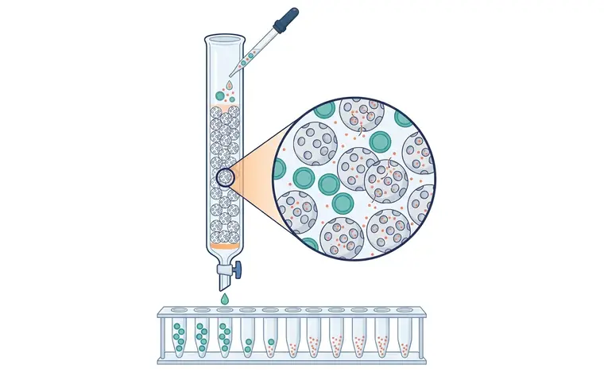
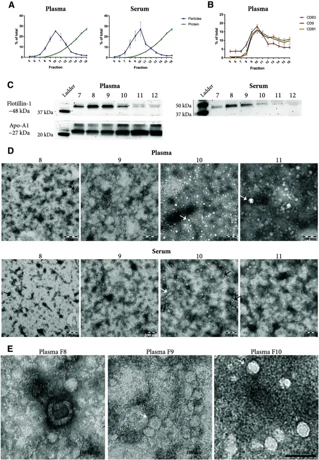
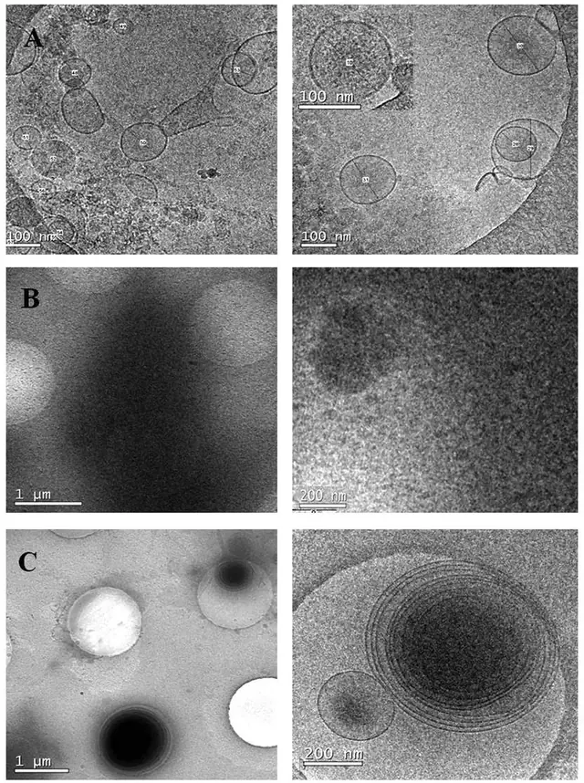

# 方法 3：尺寸排阻色谱（SEC）· 温和，保功能

> 摘自 [`docs/content-zhv1.1.md`](../docs/content-zhv1.1.md)（v1.1.0，最后核验 2026-11-13），文字逐字保留，[n] 编号与 [`references/referencesv1.1.json`](../references/referencesv1.1.json) 一致。在线互动版：<https://tuanziding.github.io/ev-isolation-guide/>
>
> **声明**：本页为方法学参考与文献综述，不构成针对任何具体课题的实验方案或结论。文中参数为已发表研究或国际细胞外囊泡学会（ISEV）指南中的报告值或常见范围，具体数值以所用仪器、转子和商品化产品说明书为准，正式实验前应在本实验室样本上小试验证。用于正式研究时，提取方案与质控标准建议预先写入研究方案或预注册。凡标注“【实验室惯例】”或“【估算】”的内容，没有直接的文献测定值支持，仅供参考。

按“分离原理”理解每种方法，才能判断它会共分离什么、损失或损伤什么 [1]。

**原理**：大颗粒不进入填料孔隙，先流出（早期级分）；比孔径小的颗粒和游离蛋白滞留更久、在后期级分流出 [1]。

**典型参数**：柱可自装或购买商品化柱，商品柱装填条件受控，可能重复性更好 [1]。必须逐段表征以确定 EV 和杂质所在级分 [1]。例如 Sepharose CL-2B 柱处理血小板来源样本时，EV 主要在第 9–12 级分 [18]。应报告填料与孔径、柱尺寸、上样量、空体积、收集级分数与体积，柱重复使用时报告再生方法和使用次数 [1]。

**优点**：在血小板来源样本中，EV 富集级分仅含 <5% 的 HDL 和 <1% 的蛋白 [18]；在血浆中，SEC 去除了大部分可溶性蛋白，而 PEG 不能 [19]。与超离相比，超滤联合 SEC 得到的 EV 得率更高、生物物理性质保存更好 [3]；在一项心肌祖细胞 EV 研究中，SEC-EV 的体外功能读出高于超离 EV [20]。

**局限**：SEC 只按大小分离，与 EV 大小相近的较大脂蛋白颗粒会共洗脱（MISEV2023 指出除 HDL 外的脂蛋白与 EV 大小重叠）[1]；血浆 SEC 的 EV 级分含脂蛋白颗粒 [17]、ApoB⁺ 脂蛋白 [21]，LDL 可模拟 EV 并与之共纯化 [22]。SEC 会稀释样本，常需在前或后浓缩 [1]。

**优化要点**：大体积样本先超滤/TFF 浓缩再上柱 [3,23]；逐段检测、不要盲目合并级分 [1]；需要去除脂蛋白时联合密度分离 [17]。

**定性评分**（定性共识，非测量值）：纯度 4/5 · 得率 4/5 · 通量 3/5。

## 相关图片

点击缩略图查看原图。标“AI 示意图 · 非实验数据”的是帮助理解原理的 AI 生成示意图；标“文献原图 · CC BY 4.0”的转载自原论文，版权归原作者，按其原 CC BY 4.0 许可使用（见 [`FIGURES-LICENSES.md`](../FIGURES-LICENSES.md)），不属于本仓库的许可范围。

**尺寸排阻色谱（SEC）**（AI 示意图 · 非实验数据）

1. 上样；2. 多孔填料（如 Sepharose CL-2B）；3. EV 绕过孔隙先流出；4. 蛋白进入孔隙、滞留；5. 早期级分：EV；6. 后期级分：可溶蛋白

样本加到多孔填料柱顶。放大圈示：EV（青色）体积大，不进入填料孔隙，从珠间空隙快速通过；游离蛋白（珊瑚色小点）进入孔隙、滞留更久。下方级分管显示 EV 先在早期级分流出，蛋白在后期级分流出。

**SEC 洗脱曲线：颗粒峰先出、蛋白峰后出——但 HDL 会跟着 EV 一起出来**（文献原图 · CC BY 4.0）

怎么读：（a）血浆/血清上 SEC 柱后，各组分颗粒（蓝，NTA）与蛋白（绿，BCA）占比：颗粒峰出现在较早的组分，大量可溶蛋白在后段组分洗脱，两峰分开正是 SEC 的价值；（b）四跨膜蛋白 CD9/CD63/CD81 的 ELISA 分布与颗粒峰大体重合；（c）Western blot 显示 EV 标志 flotillin-1 与 HDL 标志 Apo-A1 在组分 7–12 中都能检出；（d、e）负染 TEM 中黑箭头为杯状 EV 样结构，白箭头为脂蛋白样颗粒。怎么读：好的 SEC 结果是“颗粒峰与蛋白峰分离、EV 标志物集中在颗粒峰”；但本图同时提示，血浆中 HDL 与 EV 尺寸重叠，单用 SEC 无法去除，需要加做密度步骤或检测 ApoA1/ApoB。

> Reproduced from Karimi N, Cvjetkovic A, Jang SC, et al., 2018, *Cell Mol Life Sci* Fig. 2, [CC BY 4.0](https://creativecommons.org/licenses/by/4.0/), no changes. DOI: [10.1007/s00018-018-2773-4](https://doi.org/10.1007/s00018-018-2773-4) · [PMC6021463](https://pmc.ncbi.nlm.nih.gov/articles/PMC6021463/) · 文献 [17]

**冷冻电镜对比：SEC 见到单个囊泡，PEG 沉淀只见到一片致密杂质**（文献原图 · CC BY 4.0）

怎么读：（A）SEC 合并组分中可见直径约 80–200 nm 的单个囊泡，膜结构清楚；（B）PEG 沉淀样品中找不到囊泡，整张载网被电子致密颗粒覆盖，原文解读为污染物共沉淀；（C）PROSPR 方法得到的是多层同心囊泡，多数 300–500 nm。怎么读：冷冻电镜在水合状态下成像，EV 呈圆形双层膜（不出现杯状伪影）；“好”的制备物背景干净、能看到清晰的膜；如果整片是无结构的致密物，即使 NTA 颗粒数很高，也说明大部分“颗粒”不是 EV。

> Reproduced from Gámez-Valero A, Monguió-Tortajada M, Carreras-Planella L, et al., 2016, *Sci Rep* Figure 5, [CC BY 4.0](https://creativecommons.org/licenses/by/4.0/), no changes. DOI: [10.1038/srep33641](https://doi.org/10.1038/srep33641) · [PMC5027519](https://pmc.ncbi.nlm.nih.gov/articles/PMC5027519/) · 文献 [19]

## 本文引用的参考文献

[1] Welsh JA, Goberdhan DCI, O'Driscoll L, Buzas EI, Blenkiron C, Bussolati B, et al. Minimal information for studies of extracellular vesicles (MISEV2023): From basic to advanced approaches. J Extracell Vesicles. 2024;13:e12404. doi:[10.1002/jev2.12404](https://doi.org/10.1002/jev2.12404). PMID:[38326288](https://pubmed.ncbi.nlm.nih.gov/38326288/); [PMC10850029](https://pmc.ncbi.nlm.nih.gov/articles/PMC10850029/).

[3] Nordin JZ, Lee Y, Vader P, Mäger I, Johansson HJ, Heusermann W, et al. Ultrafiltration with size-exclusion liquid chromatography for high yield isolation of extracellular vesicles preserving intact biophysical and functional properties. Nanomedicine. 2015;11:879-883. doi:[10.1016/j.nano.2015.01.003](https://doi.org/10.1016/j.nano.2015.01.003). PMID:[25659648](https://pubmed.ncbi.nlm.nih.gov/25659648/).

[17] Karimi N, Cvjetkovic A, Jang SC, Crescitelli R, Hosseinpour Feizi MA, Nieuwland R, et al. Detailed analysis of the plasma extracellular vesicle proteome after separation from lipoproteins. Cell Mol Life Sci. 2018;75:2873-2886. doi:[10.1007/s00018-018-2773-4](https://doi.org/10.1007/s00018-018-2773-4). PMID:[29441425](https://pubmed.ncbi.nlm.nih.gov/29441425/); [PMC6021463](https://pmc.ncbi.nlm.nih.gov/articles/PMC6021463/).

[18] Böing AN, van der Pol E, Grootemaat AE, Coumans FA, Sturk A, Nieuwland R. Single-step isolation of extracellular vesicles by size-exclusion chromatography. J Extracell Vesicles. 2014;3:23430. doi:[10.3402/jev.v3.23430](https://doi.org/10.3402/jev.v3.23430). PMID:[25279113](https://pubmed.ncbi.nlm.nih.gov/25279113/); [PMC4159761](https://pmc.ncbi.nlm.nih.gov/articles/PMC4159761/).

[19] Gámez-Valero A, Monguió-Tortajada M, Carreras-Planella L, Franquesa Ml, Beyer K, Borràs FE. Size-Exclusion Chromatography-based isolation minimally alters Extracellular Vesicles' characteristics compared to precipitating agents. Sci Rep. 2016;6:33641. doi:[10.1038/srep33641](https://doi.org/10.1038/srep33641). PMID:[27640641](https://pubmed.ncbi.nlm.nih.gov/27640641/); [PMC5027519](https://pmc.ncbi.nlm.nih.gov/articles/PMC5027519/).

[20] Mol EA, Goumans MJ, Doevendans PA, Sluijter JPG, Vader P. Higher functionality of extracellular vesicles isolated using size-exclusion chromatography compared to ultracentrifugation. Nanomedicine. 2017;13:2061-2065. doi:[10.1016/j.nano.2017.03.011](https://doi.org/10.1016/j.nano.2017.03.011). PMID:[28365418](https://pubmed.ncbi.nlm.nih.gov/28365418/).

[21] Takov K, Yellon DM, Davidson SM. Comparison of small extracellular vesicles isolated from plasma by ultracentrifugation or size-exclusion chromatography: yield, purity and functional potential. J Extracell Vesicles. 2019;8:1560809. doi:[10.1080/20013078.2018.1560809](https://doi.org/10.1080/20013078.2018.1560809). PMID:[30651940](https://pubmed.ncbi.nlm.nih.gov/30651940/); [PMC6327926](https://pmc.ncbi.nlm.nih.gov/articles/PMC6327926/).

[22] Sódar BW, Kittel Á, Pálóczi K, Vukman KV, Osteikoetxea X, Szabó-Taylor K, et al. Low-density lipoprotein mimics blood plasma-derived exosomes and microvesicles during isolation and detection. Sci Rep. 2016;6:24316. doi:[10.1038/srep24316](https://doi.org/10.1038/srep24316). PMID:[27087061](https://pubmed.ncbi.nlm.nih.gov/27087061/); [PMC4834552](https://pmc.ncbi.nlm.nih.gov/articles/PMC4834552/).

[23] Benedikter BJ, Bouwman FG, Vajen T, Heinzmann ACA, Grauls G, Mariman EC, et al. Ultrafiltration combined with size exclusion chromatography efficiently isolates extracellular vesicles from cell culture media for compositional and functional studies. Sci Rep. 2017;7:15297. doi:[10.1038/s41598-017-15717-7](https://doi.org/10.1038/s41598-017-15717-7). PMID:[29127410](https://pubmed.ncbi.nlm.nih.gov/29127410/); [PMC5681555](https://pmc.ncbi.nlm.nih.gov/articles/PMC5681555/).
