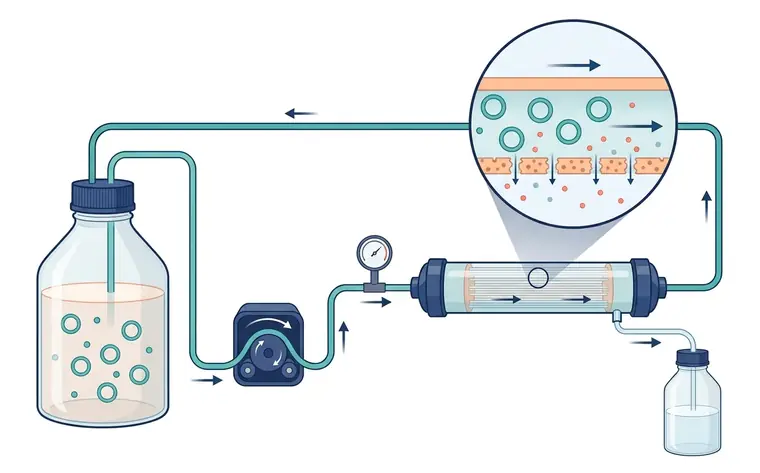
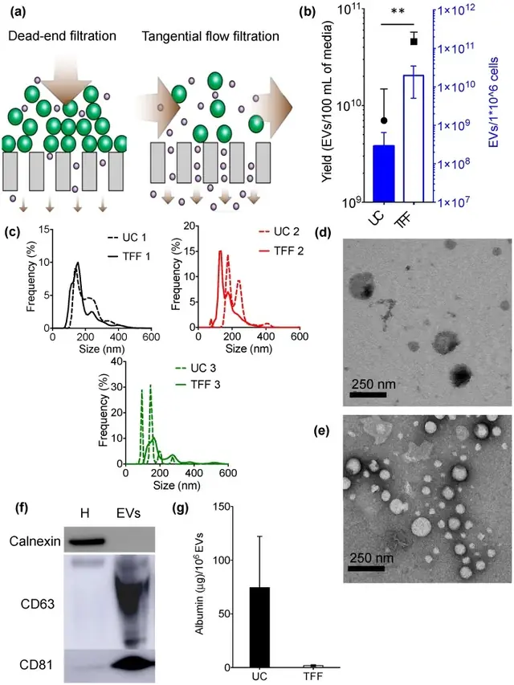

# 方法 4：超滤与切向流过滤（UF / TFF）· 浓缩利器

> 摘自 [`docs/content-zhv1.1.md`](../docs/content-zhv1.1.md)（v1.1.0，最后核验 2026-11-13），文字逐字保留，[n] 编号与 [`references/referencesv1.1.json`](../references/referencesv1.1.json) 一致。在线互动版：<https://tuanziding.github.io/ev-isolation-guide/>
>
> **声明**：本页为方法学参考与文献综述，不构成针对任何具体课题的实验方案或结论。文中参数为已发表研究或国际细胞外囊泡学会（ISEV）指南中的报告值或常见范围，具体数值以所用仪器、转子和商品化产品说明书为准，正式实验前应在本实验室样本上小试验证。用于正式研究时，提取方案与质控标准建议预先写入研究方案或预注册。凡标注“【实验室惯例】”或“【估算】”的内容，没有直接的文献测定值支持，仅供参考。

按“分离原理”理解每种方法，才能判断它会共分离什么、损失或损伤什么 [1]。

**原理**：按膜截留分离与浓缩。死端过滤中较大颗粒易堵塞膜孔；TFF 中液流平行于膜面，避免滤饼形成，可连续处理大体积 [1,4]。

**典型参数**：文献中所用截留值差异较大，例如离心超滤 100 kDa [13]、10 kDa 离心超滤后接 SEC [23]、TFF 中空纤维 500 kDa（前接 0.65 µm 预过滤）[4]。应报告膜类型、截留值等参数 [1]；跨膜压、流速与换液（diafiltration）的具体设置以设备说明为准【实验室惯例】。

**优点**：与超离相比，TFF 浓缩细胞培养基的 EV 得率更高、单分子和聚集体更少、批间一致性更好，处理时间约 1 h，且可放大 [4]；在间充质干细胞 3D 培养中，TFF 使外泌体得率比超离高 7 倍 [24]。

**局限**：浓缩不等于纯化——产物所含非囊泡颗粒和蛋白的量取决于方法和截留值 [1]；不同滤膜对 EV 的吸附（“粘附”）程度不同，影响回收 [1]；浓缩器件的选择可显著影响得率 [13]。

**优化要点**：把 UF/TFF 定位为“浓缩步”，随后接 SEC 或密度梯度纯化 [1,3,23]；预过滤防堵 [4]；回收时少量缓冲液润洗膜面【实验室惯例】。

**定性评分**（定性共识，非测量值）：纯度 2/5 · 得率 4/5 · 通量 5/5。

## 相关图片

点击缩略图查看原图。标“AI 示意图 · 非实验数据”的是帮助理解原理的 AI 生成示意图；标“文献原图 · CC BY 4.0”的转载自原论文，版权归原作者，按其原 CC BY 4.0 许可使用（见 [`FIGURES-LICENSES.md`](../FIGURES-LICENSES.md)），不属于本仓库的许可范围。

**切向流过滤（TFF）**（AI 示意图 · 非实验数据）

1. 储液瓶（样本）；2. 蠕动泵；3. 压力表；4. 中空纤维滤柱；5. 截留液回流（含 EV）；6. 透过液（水、小分子）；7. 平行于膜面的液流；8. 膜孔

闭合回路：储液瓶中的培养上清经蠕动泵送入中空纤维滤柱，截留液（含 EV）返回储液瓶持续浓缩，透过液从滤柱侧口流入废液瓶；压力表监测管路压力。放大圈示液流平行于膜面，EV 留在纤维腔内，水和小分子蛋白穿过膜孔。

**TFF 与超速离心正面对比：产量、粒径、形貌、标志物和白蛋白残留**（文献原图 · CC BY 4.0）

怎么读：（a）死端过滤与切向流过滤的原理示意：TFF 液流平行于膜面，减少滤膜堵塞；（b）EV 产量（TFF 显著高于 UC）；（c）三次重复的粒径分布（虚线 UC，实线 TFF）；（d、e）UC 与 TFF 所得 EV 的 TEM；（f）TFF 样品 Western blot：EV 中检出 CD63、CD81，不含细胞内标志 calnexin（H 为细胞匀浆对照）；（g）每 10⁶ 个 EV 的白蛋白残留，TFF 低于 UC。怎么读：一张合格的方法比较图应同时给出产量、粒径、形貌、阳性/阴性标志物和一个“污染物”指标（这里是白蛋白），而不是只比颗粒数。

> Reproduced from Busatto S, Vilanilam G, Ticer T, et al., 2018, *Cells* Figure 1, [CC BY 4.0](https://creativecommons.org/licenses/by/4.0/), no changes. DOI: [10.3390/cells7120273](https://doi.org/10.3390/cells7120273) · [PMC6315734](https://pmc.ncbi.nlm.nih.gov/articles/PMC6315734/) · 文献 [4]

## 本文引用的参考文献

[1] Welsh JA, Goberdhan DCI, O'Driscoll L, Buzas EI, Blenkiron C, Bussolati B, et al. Minimal information for studies of extracellular vesicles (MISEV2023): From basic to advanced approaches. J Extracell Vesicles. 2024;13:e12404. doi:[10.1002/jev2.12404](https://doi.org/10.1002/jev2.12404). PMID:[38326288](https://pubmed.ncbi.nlm.nih.gov/38326288/); [PMC10850029](https://pmc.ncbi.nlm.nih.gov/articles/PMC10850029/).

[3] Nordin JZ, Lee Y, Vader P, Mäger I, Johansson HJ, Heusermann W, et al. Ultrafiltration with size-exclusion liquid chromatography for high yield isolation of extracellular vesicles preserving intact biophysical and functional properties. Nanomedicine. 2015;11:879-883. doi:[10.1016/j.nano.2015.01.003](https://doi.org/10.1016/j.nano.2015.01.003). PMID:[25659648](https://pubmed.ncbi.nlm.nih.gov/25659648/).

[4] Busatto S, Vilanilam G, Ticer T, Lin WL, Dickson DW, Shapiro S, et al. Tangential Flow Filtration for Highly Efficient Concentration of Extracellular Vesicles from Large Volumes of Fluid. Cells. 2018;7:273. doi:[10.3390/cells7120273](https://doi.org/10.3390/cells7120273). PMID:[30558352](https://pubmed.ncbi.nlm.nih.gov/30558352/); [PMC6315734](https://pmc.ncbi.nlm.nih.gov/articles/PMC6315734/).

[13] Lobb RJ, Becker M, Wen SW, Wong CS, Wiegmans AP, Leimgruber A, et al. Optimized exosome isolation protocol for cell culture supernatant and human plasma. J Extracell Vesicles. 2015;4:27031. doi:[10.3402/jev.v4.27031](https://doi.org/10.3402/jev.v4.27031). PMID:[26194179](https://pubmed.ncbi.nlm.nih.gov/26194179/); [PMC4507751](https://pmc.ncbi.nlm.nih.gov/articles/PMC4507751/).

[23] Benedikter BJ, Bouwman FG, Vajen T, Heinzmann ACA, Grauls G, Mariman EC, et al. Ultrafiltration combined with size exclusion chromatography efficiently isolates extracellular vesicles from cell culture media for compositional and functional studies. Sci Rep. 2017;7:15297. doi:[10.1038/s41598-017-15717-7](https://doi.org/10.1038/s41598-017-15717-7). PMID:[29127410](https://pubmed.ncbi.nlm.nih.gov/29127410/); [PMC5681555](https://pmc.ncbi.nlm.nih.gov/articles/PMC5681555/).

[24] Haraszti RA, Miller R, Stoppato M, Sere YY, Coles A, Didiot MC, et al. Exosomes Produced from 3D Cultures of MSCs by Tangential Flow Filtration Show Higher Yield and Improved Activity. Mol Ther. 2018;26:2838-2847. doi:[10.1016/j.ymthe.2018.09.015](https://doi.org/10.1016/j.ymthe.2018.09.015). PMID:[30341012](https://pubmed.ncbi.nlm.nih.gov/30341012/); [PMC6277553](https://pmc.ncbi.nlm.nih.gov/articles/PMC6277553/).
