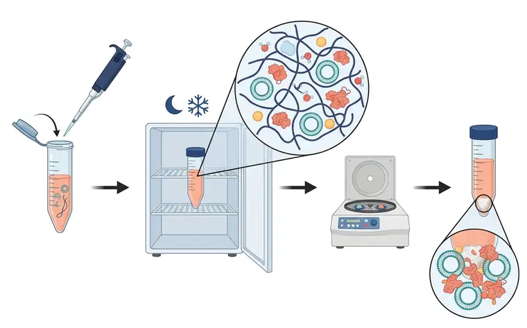
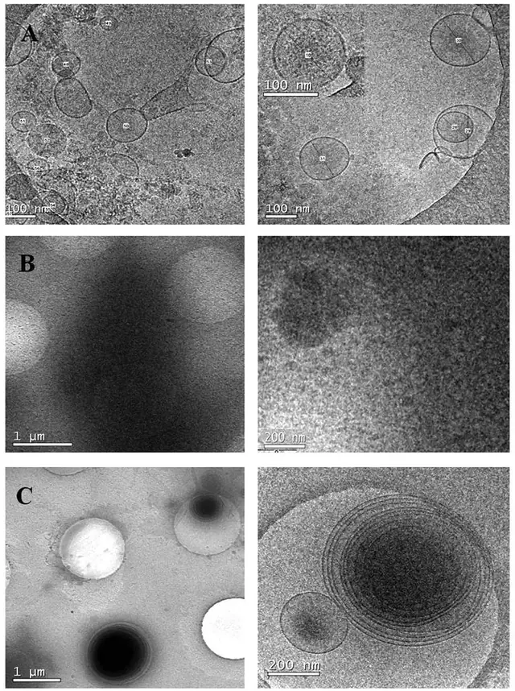

# 方法 5：聚合物沉淀（PEG 等试剂盒）· 方便但特异性最低

> 摘自 [`docs/content-zhv1.1.md`](../docs/content-zhv1.1.md)（v1.1.0，最后核验 2026-11-13），文字逐字保留，[n] 编号与 [`references/referencesv1.1.json`](../references/referencesv1.1.json) 一致。在线互动版：<https://tuanziding.github.io/ev-isolation-guide/>
>
> **声明**：本页为方法学参考与文献综述，不构成针对任何具体课题的实验方案或结论。文中参数为已发表研究或国际细胞外囊泡学会（ISEV）指南中的报告值或常见范围，具体数值以所用仪器、转子和商品化产品说明书为准，正式实验前应在本实验室样本上小试验证。用于正式研究时，提取方案与质控标准建议预先写入研究方案或预注册。凡标注“【实验室惯例】”或“【估算】”的内容，没有直接的文献测定值支持，仅供参考。

按“分离原理”理解每种方法，才能判断它会共分离什么、损失或损伤什么 [1]。

**原理**：聚合物“挤出”水分子、降低生物分子溶剂可及性，使包括 EV 在内的颗粒能被低速离心沉淀；许多所谓“外泌体提取试剂盒”即基于此原理，并不真正“分离” EV [1]。

**典型参数**：例如 ExtraPEG 方案：加入 PEG 后 4 °C 孵育过夜（≥12 h），台式离心机 3,214×g 离心 1 h，再加一步小体积超离纯化 [25]。商品试剂盒按说明书操作。

**优点**：不依赖超离机、操作简便、成本低，可处理大体积 [25]。

**局限**：沉淀法可能达不到明显的颗粒分离效果 [1]；血浆中 PEG 未能去除大量可溶性蛋白，且影响 EV 标志物检测 [19]；在纯度和组学结果上不如密度梯度 [2]。试剂盒得到的“颗粒数”可比超离高 2–4 个数量级，但纯度低得多——高颗粒数不等于高 EV 得率 [12]。

**优化要点**：仅建议用于探索性筛查，或后续仍有纯化步骤时使用 [1]；用于组学/功能结论前加一步 SEC 等纯化，并如实报告【实验室惯例，依据上述局限】。

**定性评分**（定性共识，非测量值）：纯度 1/5 · 颗粒回收 5/5（非 EV 特异）· 通量 4/5。

## 相关图片

点击缩略图查看原图。标“AI 示意图 · 非实验数据”的是帮助理解原理的 AI 生成示意图；标“文献原图 · CC BY 4.0”的转载自原论文，版权归原作者，按其原 CC BY 4.0 许可使用（见 [`FIGURES-LICENSES.md`](../FIGURES-LICENSES.md)），不属于本仓库的许可范围。

**聚合物（PEG）沉淀**（AI 示意图 · 非实验数据）

1. 加入 PEG；2. 4 °C 孵育过夜；3. 聚合物网非特异地网罗颗粒；4. 台式离心（低速）；5. 沉淀：EV + 蛋白 + 脂蛋白

向样本加入聚合物溶液，4 °C 孵育过夜；放大圈示长链聚合物形成网状结构、排挤水分子，把 EV 与蛋白团块、脂蛋白颗粒一并“网住”；经台式低速离心后得到较大的沉淀，放大圈显示其中 EV 与大量蛋白及其他颗粒混杂，纯度低。

**冷冻电镜对比：SEC 见到单个囊泡，PEG 沉淀只见到一片致密杂质**（文献原图 · CC BY 4.0）

怎么读：（A）SEC 合并组分中可见直径约 80–200 nm 的单个囊泡，膜结构清楚；（B）PEG 沉淀样品中找不到囊泡，整张载网被电子致密颗粒覆盖，原文解读为污染物共沉淀；（C）PROSPR 方法得到的是多层同心囊泡，多数 300–500 nm。怎么读：冷冻电镜在水合状态下成像，EV 呈圆形双层膜（不出现杯状伪影）；“好”的制备物背景干净、能看到清晰的膜；如果整片是无结构的致密物，即使 NTA 颗粒数很高，也说明大部分“颗粒”不是 EV。

> Reproduced from Gámez-Valero A, Monguió-Tortajada M, Carreras-Planella L, et al., 2016, *Sci Rep* Figure 5, [CC BY 4.0](https://creativecommons.org/licenses/by/4.0/), no changes. DOI: [10.1038/srep33641](https://doi.org/10.1038/srep33641) · [PMC5027519](https://pmc.ncbi.nlm.nih.gov/articles/PMC5027519/) · 文献 [19]

## 本文引用的参考文献

[1] Welsh JA, Goberdhan DCI, O'Driscoll L, Buzas EI, Blenkiron C, Bussolati B, et al. Minimal information for studies of extracellular vesicles (MISEV2023): From basic to advanced approaches. J Extracell Vesicles. 2024;13:e12404. doi:[10.1002/jev2.12404](https://doi.org/10.1002/jev2.12404). PMID:[38326288](https://pubmed.ncbi.nlm.nih.gov/38326288/); [PMC10850029](https://pmc.ncbi.nlm.nih.gov/articles/PMC10850029/).

[2] Van Deun J, Mestdagh P, Sormunen R, Cocquyt V, Vermaelen K, Vandesompele J, et al. The impact of disparate isolation methods for extracellular vesicles on downstream RNA profiling. J Extracell Vesicles. 2014;3:24858. doi:[10.3402/jev.v3.24858](https://doi.org/10.3402/jev.v3.24858). PMID:[25317274](https://pubmed.ncbi.nlm.nih.gov/25317274/); [PMC4169610](https://pmc.ncbi.nlm.nih.gov/articles/PMC4169610/).

[12] Tian Y, Gong M, Hu Y, Liu H, Zhang W, Zhang M, et al. Quality and efficiency assessment of six extracellular vesicle isolation methods by nano-flow cytometry. J Extracell Vesicles. 2020;9:1697028. doi:[10.1080/20013078.2019.1697028](https://doi.org/10.1080/20013078.2019.1697028). PMID:[31839906](https://pubmed.ncbi.nlm.nih.gov/31839906/); [PMC6896440](https://pmc.ncbi.nlm.nih.gov/articles/PMC6896440/).

[19] Gámez-Valero A, Monguió-Tortajada M, Carreras-Planella L, Franquesa Ml, Beyer K, Borràs FE. Size-Exclusion Chromatography-based isolation minimally alters Extracellular Vesicles' characteristics compared to precipitating agents. Sci Rep. 2016;6:33641. doi:[10.1038/srep33641](https://doi.org/10.1038/srep33641). PMID:[27640641](https://pubmed.ncbi.nlm.nih.gov/27640641/); [PMC5027519](https://pmc.ncbi.nlm.nih.gov/articles/PMC5027519/).

[25] Rider MA, Hurwitz SN, Meckes DG Jr. ExtraPEG: A Polyethylene Glycol-Based Method for Enrichment of Extracellular Vesicles. Sci Rep. 2016;6:23978. doi:[10.1038/srep23978](https://doi.org/10.1038/srep23978). PMID:[27068479](https://pubmed.ncbi.nlm.nih.gov/27068479/); [PMC4828635](https://pmc.ncbi.nlm.nih.gov/articles/PMC4828635/).
