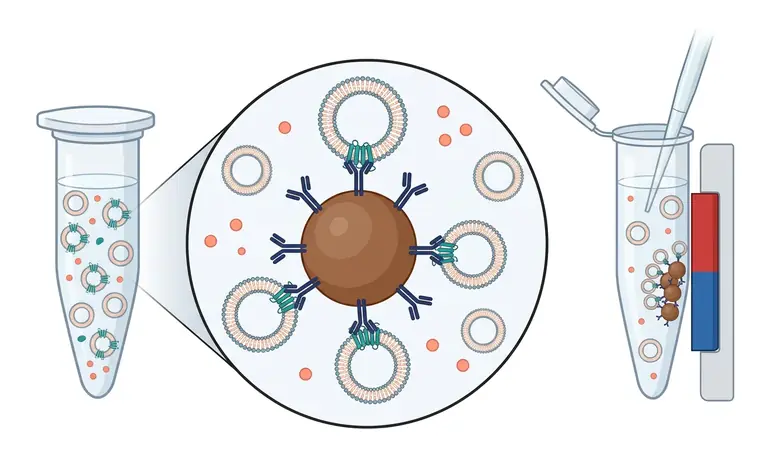

# 方法 6：免疫亲和捕获 · 亚群富集专用

> 摘自 [`docs/content-zhv1.1.md`](../docs/content-zhv1.1.md)（v1.1.0，最后核验 2026-11-13），文字逐字保留，[n] 编号与 [`references/referencesv1.1.json`](../references/referencesv1.1.json) 一致。在线互动版：<https://tuanziding.github.io/ev-isolation-guide/>
>
> **声明**：本页为方法学参考与文献综述，不构成针对任何具体课题的实验方案或结论。文中参数为已发表研究或国际细胞外囊泡学会（ISEV）指南中的报告值或常见范围，具体数值以所用仪器、转子和商品化产品说明书为准，正式实验前应在本实验室样本上小试验证。用于正式研究时，提取方案与质控标准建议预先写入研究方案或预注册。凡标注“【实验室惯例】”或“【估算】”的内容，没有直接的文献测定值支持，仅供参考。

按“分离原理”理解每种方法，才能判断它会共分离什么、损失或损伤什么 [1]。

**原理**：用抗体（如抗 CD63、CD81、CD9 或目标抗原）捕获暴露该决定簇的 EV 亚群 [1,26]。

**典型参数**：可先按沉降速度分离再进行免疫分离 [26]。应报告亲和探针、基质、孵育时间、洗涤和洗脱条件，并定量下拉与流穿中的物质以评估效率与选择性 [1]。

**优点**：对目标标志阳性 EV 的富集能力强；在一项结肠癌细胞系比较中，EpCAM 免疫捕获的外泌体标志蛋白富集高于超离和密度梯度 [27]。

**局限**：只得到暴露该决定簇的颗粒（包括同样暴露它的非囊泡颗粒），结果不能代表全部 EV；例如尿液中用 CD9 或 CD63 捕获会遗漏近端肾单位来源的 EV [1]。抗体难以与 EV 分离，经典低 pH 洗脱很可能影响 EV 结构，蛋白酶处理也可能消化 EV 表面蛋白 [1]。

**优化要点**：明确报告捕获抗原并声明“亚群”属性 [1]；若下游是检测读出，可在珠上直接检测【实验室惯例】；用于功能实验需谨慎，因为 EV 表面被结合分子修饰 [1]。

**定性评分**（定性共识，非测量值）：特异性（针对目标亚群）4/5 · 得率 1/5 · 通量 2/5。

## 相关图片

点击缩略图查看原图。标“AI 示意图 · 非实验数据”的是帮助理解原理的 AI 生成示意图；标“文献原图 · CC BY 4.0”的转载自原论文，版权归原作者，按其原 CC BY 4.0 许可使用（见 [`FIGURES-LICENSES.md`](../FIGURES-LICENSES.md)），不属于本仓库的许可范围。

**免疫亲和捕获（磁珠）**（AI 示意图 · 非实验数据）

1. 混合样本；2. 抗体包被磁珠；3. CD63⁺ EV 被捕获；4. CD63⁻ EV 未被捕获；5. 磁力架；6. 被捕获的亚群；7. 吸走流穿液

样本中既有带目标四跨膜蛋白（如 CD63）的 EV，也有不带该标志的 EV 和游离蛋白。放大圈示磁珠表面的抗体只结合暴露目标抗原的囊泡；其余囊泡与蛋白不被结合。右侧磁力架把磁珠及其捕获的亚群吸到管壁，流穿液被吸走。

## 本文引用的参考文献

[1] Welsh JA, Goberdhan DCI, O'Driscoll L, Buzas EI, Blenkiron C, Bussolati B, et al. Minimal information for studies of extracellular vesicles (MISEV2023): From basic to advanced approaches. J Extracell Vesicles. 2024;13:e12404. doi:[10.1002/jev2.12404](https://doi.org/10.1002/jev2.12404). PMID:[38326288](https://pubmed.ncbi.nlm.nih.gov/38326288/); [PMC10850029](https://pmc.ncbi.nlm.nih.gov/articles/PMC10850029/).

[26] Kowal J, Arras G, Colombo M, Jouve M, Morath JP, Primdal-Bengtson B, et al. Proteomic comparison defines novel markers to characterize heterogeneous populations of extracellular vesicle subtypes. Proc Natl Acad Sci U S A. 2016;113:E968-E977. doi:[10.1073/pnas.1521230113](https://doi.org/10.1073/pnas.1521230113). PMID:[26858453](https://pubmed.ncbi.nlm.nih.gov/26858453/); [PMC4776515](https://pmc.ncbi.nlm.nih.gov/articles/PMC4776515/).

[27] Tauro BJ, Greening DW, Mathias RA, Ji H, Mathivanan S, Scott AM, et al. Comparison of ultracentrifugation, density gradient separation, and immunoaffinity capture methods for isolating human colon cancer cell line LIM1863-derived exosomes. Methods. 2012;56:293-304. doi:[10.1016/j.ymeth.2012.01.002](https://doi.org/10.1016/j.ymeth.2012.01.002). PMID:[22285593](https://pubmed.ncbi.nlm.nih.gov/22285593/).
