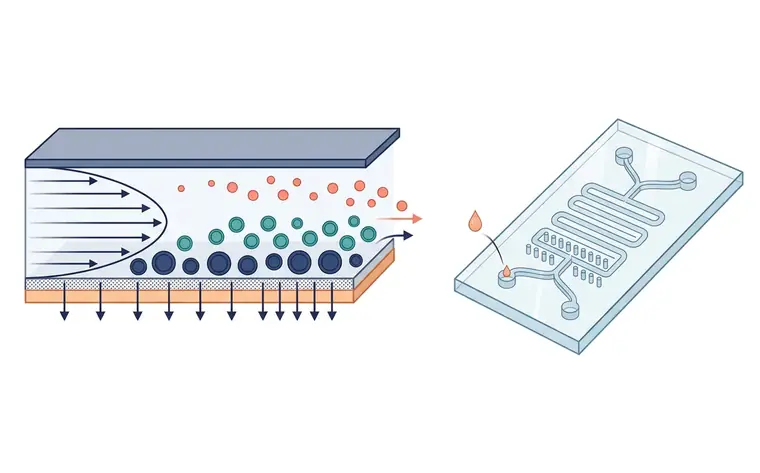
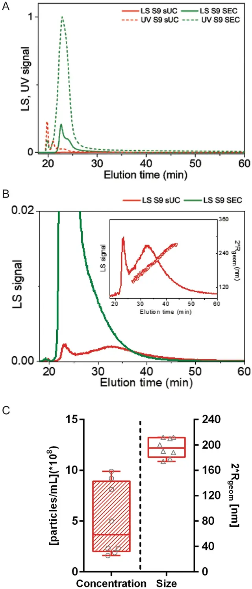

# 方法 7：微流控与非对称流场流分离（AF4 等）· 分析级

> 摘自 [`docs/content-zhv1.1.md`](../docs/content-zhv1.1.md)（v1.1.0，最后核验 2026-11-13），文字逐字保留，[n] 编号与 [`references/referencesv1.1.json`](../references/referencesv1.1.json) 一致。在线互动版：<https://tuanziding.github.io/ev-isolation-guide/>
>
> **声明**：本页为方法学参考与文献综述，不构成针对任何具体课题的实验方案或结论。文中参数为已发表研究或国际细胞外囊泡学会（ISEV）指南中的报告值或常见范围，具体数值以所用仪器、转子和商品化产品说明书为准，正式实验前应在本实验室样本上小试验证。用于正式研究时，提取方案与质控标准建议预先写入研究方案或预注册。凡标注“【实验室惯例】”或“【估算】”的内容，没有直接的文献测定值支持，仅供参考。

按“分离原理”理解每种方法，才能判断它会共分离什么、损失或损伤什么 [1]。

**原理**：微流控平台整合多种基于大小、电荷或亲和的分离与检测方式 [28,29]。AF4 在无固定相的薄通道中按流体力学尺寸分离颗粒 [1]。

**典型参数**：依平台而定。AF4 曾分出大外泌体（90–120 nm）、小外泌体（60–80 nm）和无膜纳米颗粒“exomere”（约 35 nm）[30]。**更正**：supermere 并非用 AF4 分出，而是将 exomere 沉淀后的上清再以 367,000×g 超离获得 [31]。

**优点**：流场类方法无固定相、颗粒回收高，属最温和的分离方法之一；AF4 能精确分开大小差异小的颗粒群 [1]。

**局限**：AF4 标准配置并不对 EV 特异，也不是制备型技术 [1]；某些微流控装置得率高，但当输入样本中非 EV 颗粒多时可能共分离杂质 [5]。设备与方法学标准化程度较低【作者判断】。

**优化要点**：定位为分析与亚群研究工具，不作为常规制备主力 [1]；报告芯片/通道与运行参数以便复现 [1]。

**定性评分**（定性共识，非测量值）：纯度 3/5（按尺寸分辨率高但非 EV 特异）· 回收 3/5（回收高但处理量小）· 通量/制备量 1/5。

> 缺口：exomere 的 AF4 洗脱曲线没有找到开放许可的原图，请看原文 Zhang 2018 [30]（[doi:10.1038/s41556-018-0040-4](https://doi.org/10.1038/s41556-018-0040-4)）。

## 相关图片

点击缩略图查看原图。标“AI 示意图 · 非实验数据”的是帮助理解原理的 AI 生成示意图；标“文献原图 · CC BY 4.0”的转载自原论文，版权归原作者，按其原 CC BY 4.0 许可使用（见 [`FIGURES-LICENSES.md`](../FIGURES-LICENSES.md)），不属于本仓库的许可范围。

**非对称流场流分离（AF4）与微流控芯片**（AI 示意图 · 非实验数据）

1. 抛物线层流；2. 横向流（crossflow）；3. 超滤膜；4. 小颗粒（如 exomere）先流出；5. 较大 EV 后流出；6. 出口；7. 微流控芯片

左：AF4 薄通道侧视图，无固定相。沿通道为抛物线型层流，垂直方向的横向流（crossflow）穿过底部超滤膜；小颗粒扩散得更高、处于更快的流线，先流出；较大囊泡靠近膜、后流出。右：带进样口、蛇形通道和微柱阵列的微流控芯片示意。

**AF4 流场分离图（fractogram）：按洗脱时间读出颗粒大小**（文献原图 · CC BY 4.0）

怎么读：（A）同一受试者血浆经蔗糖垫超速离心（sUC，红）或 SEC（绿）富集后的 AF4 流场分离图：实线为多角度光散射（LS）信号，虚线为紫外（UV）信号；（B）LS 信号放大，插图为由 MALS 计算的洗脱颗粒几何直径（2×Rgeom），随洗脱时间增大；（C）sUC 样品的颗粒浓度与粒径（N = 8）。怎么读：AF4 中小颗粒先洗脱、大颗粒后洗脱，可以在一次运行中把不同大小的颗粒分开并测粒径；UV 信号高而 LS 信号弱的早期峰通常对应蛋白等小分子量成分。注意：本图是血浆 EV 的 AF4 测量，不是 exomere/supermere 的分离图（见“缺口”说明）。

> Reproduced from Holcar M, Ferdin J, Sitar S, et al., 2020, *Sci Rep* Figure 2, [CC BY 4.0](https://creativecommons.org/licenses/by/4.0/), no changes. DOI: [10.1038/s41598-020-78422-y](https://doi.org/10.1038/s41598-020-78422-y) · [PMC7721811](https://pmc.ncbi.nlm.nih.gov/articles/PMC7721811/) · 文献 [46]

## 本文引用的参考文献

[1] Welsh JA, Goberdhan DCI, O'Driscoll L, Buzas EI, Blenkiron C, Bussolati B, et al. Minimal information for studies of extracellular vesicles (MISEV2023): From basic to advanced approaches. J Extracell Vesicles. 2024;13:e12404. doi:[10.1002/jev2.12404](https://doi.org/10.1002/jev2.12404). PMID:[38326288](https://pubmed.ncbi.nlm.nih.gov/38326288/); [PMC10850029](https://pmc.ncbi.nlm.nih.gov/articles/PMC10850029/).

[5] Dong L, Zieren RC, Horie K, Kim CJ, Mallick E, Jing Y, et al. Comprehensive evaluation of methods for small extracellular vesicles separation from human plasma, urine and cell culture medium. J Extracell Vesicles. 2020;10:e12044. doi:[10.1002/jev2.12044](https://doi.org/10.1002/jev2.12044). PMID:[33489012](https://pubmed.ncbi.nlm.nih.gov/33489012/); [PMC7810129](https://pmc.ncbi.nlm.nih.gov/articles/PMC7810129/).

[28] Contreras-Naranjo JC, Wu HJ, Ugaz VM. Microfluidics for exosome isolation and analysis: enabling liquid biopsy for personalized medicine. Lab Chip. 2017;17:3558-3577. doi:[10.1039/c7lc00592j](https://doi.org/10.1039/c7lc00592j). PMID:[28832692](https://pubmed.ncbi.nlm.nih.gov/28832692/); [PMC5656537](https://pmc.ncbi.nlm.nih.gov/articles/PMC5656537/).

[29] Liangsupree T, Multia E, Riekkola ML. Modern isolation and separation techniques for extracellular vesicles. J Chromatogr A. 2021;1636:461773. doi:[10.1016/j.chroma.2020.461773](https://doi.org/10.1016/j.chroma.2020.461773). PMID:[33316564](https://pubmed.ncbi.nlm.nih.gov/33316564/).

[30] Zhang H, Freitas D, Kim HS, Fabijanic K, Li Z, Chen H, et al. Identification of distinct nanoparticles and subsets of extracellular vesicles by asymmetric flow field-flow fractionation. Nat Cell Biol. 2018;20:332-343. doi:[10.1038/s41556-018-0040-4](https://doi.org/10.1038/s41556-018-0040-4). PMID:[29459780](https://pubmed.ncbi.nlm.nih.gov/29459780/); [PMC5931706](https://pmc.ncbi.nlm.nih.gov/articles/PMC5931706/).

[31] Zhang Q, Jeppesen DK, Higginbotham JN, Graves-Deal R, Trinh VQ, Ramirez MA, et al. Supermeres are functional extracellular nanoparticles replete with disease biomarkers and therapeutic targets. Nat Cell Biol. 2021;23:1240-1254. doi:[10.1038/s41556-021-00805-8](https://doi.org/10.1038/s41556-021-00805-8). PMID:[34887515](https://pubmed.ncbi.nlm.nih.gov/34887515/); [PMC8656144](https://pmc.ncbi.nlm.nih.gov/articles/PMC8656144/).

[46] Holcar M, Ferdin J, Sitar S, Tušek-Žnidarič M, Dolžan V, Plemenitaš A, et al. Enrichment of plasma extracellular vesicles for reliable quantification of their size and concentration for biomarker discovery. Sci Rep. 2020;10:21346. doi:[10.1038/s41598-020-78422-y](https://doi.org/10.1038/s41598-020-78422-y). PMID:[33288809](https://pubmed.ncbi.nlm.nih.gov/33288809/); [PMC7721811](https://pmc.ncbi.nlm.nih.gov/articles/PMC7721811/).
