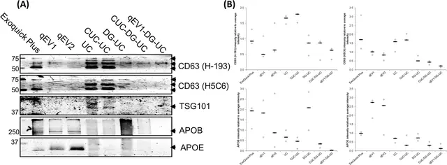
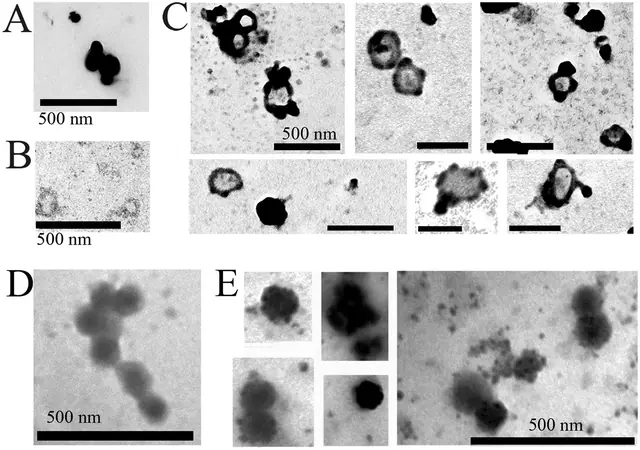
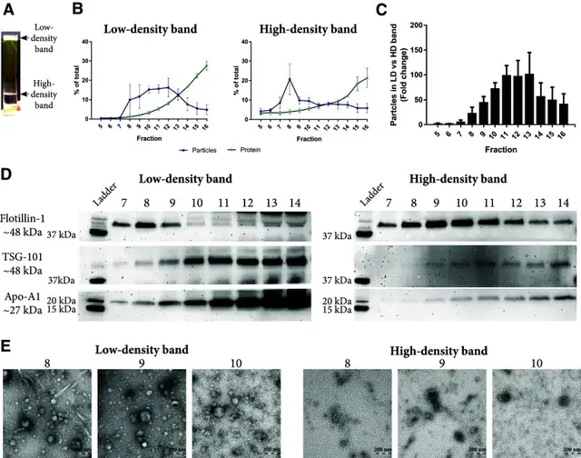
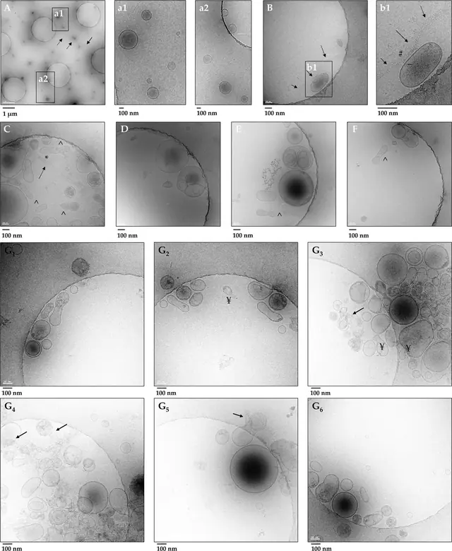
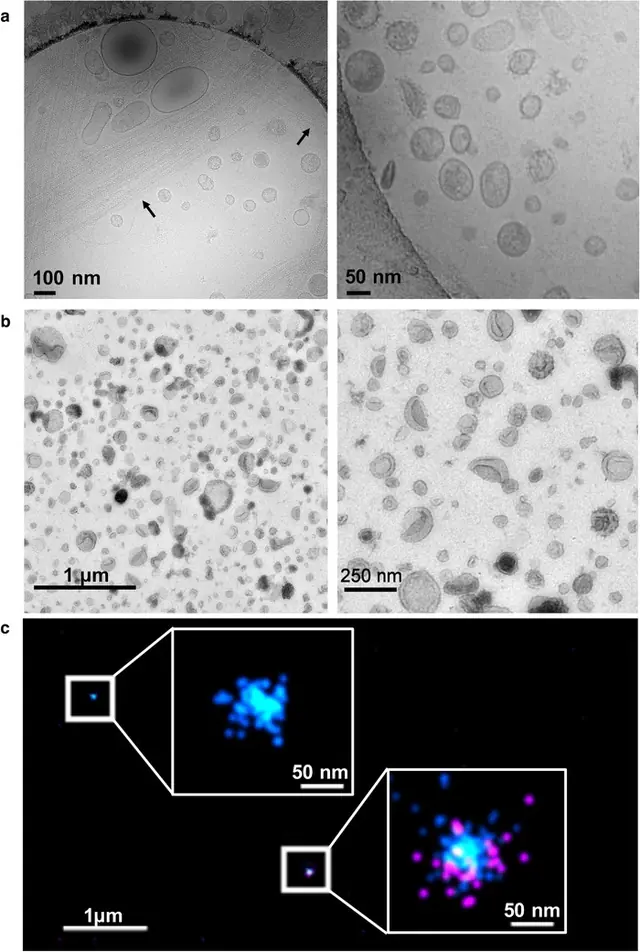
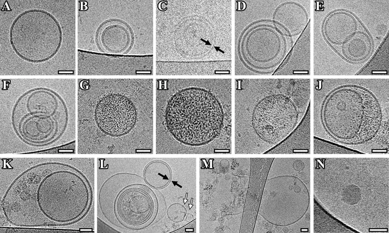
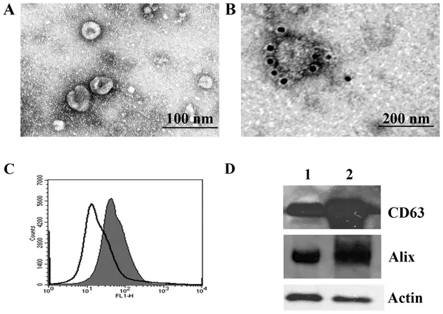

# 分样本优化要点

> 摘自 [`文档/指南正文v1.2.md`](../../文档/指南正文v1.2.md)（v1.2.0，最后核验 2026-11-13），文字逐字保留，[n] 编号与 [`验证/参考文献v1.1.json`](../../验证/参考文献v1.1.json) 一致。在线互动版：<https://tuanziding.github.io/ev-isolation-guide/>
>
> 许可：本文文字采用 [CC BY-NC 4.0](https://creativecommons.org/licenses/by-nc/4.0/)；商业用途需事先联系作者获得授权合作（<https://tuanziding.github.io/#contact>）。
>
> **声明**：本页为方法学参考与文献综述，不构成针对任何具体课题的实验方案或结论。文中参数为已发表研究或国际细胞外囊泡学会（ISEV）指南中的报告值或常见范围，具体数值以所用仪器、转子和商品化产品说明书为准，正式实验前应在本实验室样本上小试验证。用于正式研究时，提取方案与质控标准建议预先写入研究方案或预注册。凡标注“【实验室惯例】”或“【估算】”的内容，没有直接的文献测定值支持，仅供参考。

| 样本 | 主要干扰物 | 推荐路线 | 关键优化 |
|---|---|---|---|
| 细胞上清 | 血清来源 EV 与蛋白、死亡细胞来源颗粒 [1,32] | TFF/超滤 + SEC 或 dUC（± SEC/密度梯度）[2,3,4] | 去 EV 血清（验证残留）或无血清窗口；报告活率；设未条件化培养基对照 [1,33] |
| 血浆 | 血小板、脂蛋白、溶血产物、可溶/聚集蛋白 [1,34] | SEC（需去脂蛋白时联合密度分离）；避免单用沉淀法 [17,19] | 空腹采血（降低乳糜微粒）；粗针头减少血小板活化与溶血；尽快处理 [1]；ISTH 方案：采血后 <2 h 内、室温 2,500×g 15 min 离心两次（不用刹车）制备无血小板血浆 [35]；量化残余血小板 [36]；填写 MIBlood-EV [1,34] |
| 血清 | 凝血过程中血小板释放的 EV（可占血清 EV 的 50% 以上）[37] | 同血浆；EV 循环研究优先用血浆 [37] | 报告促凝剂与凝血时间 [34]；血清与血浆数据不可直接混用 [37] |
| 尿液 | Tamm–Horsfall 蛋白（尿调蛋白）聚合网罗 EV 并共分离；尿蛋白 [1] | 超滤浓缩 + SEC；或还原剂处理后 dUC [1,38,39] | DTT 等还原剂可解聚 THP 网络、释放 EV [38]，但也有报告得率改善有限 [39]，处理方式需写入方法；归一化尚无共识，可用计时尿排泄率或按渗透压/肌酐近似 [1,39] |
| 脑脊液 / 唾液等 | 总量低；黏液（唾液） | 超滤浓缩 + SEC；或免疫捕获【实验室惯例】 | 全程使用低吸附耗材【实验室惯例】；唾液先离心去黏液层并记录收集方式【实验室惯例】 |
| 组织 / 类器官 | 细胞与细胞碎片伪影 [1] | 依样本选择 | 重点追踪应在 EV 中被耗竭的细胞组分 [1] |

> 缺口：尿液样本 DTT 还原处理前后的对比没有找到开放许可的原图，请看原文 Fernández-Llama 2010 [38]（[doi:10.1038/ki.2009.550](https://doi.org/10.1038/ki.2009.550)）。

## 相关图片

点击缩略图查看原图。标“AI 示意图 · 非实验数据”的是帮助理解原理的 AI 生成示意图；标“文献原图 · CC BY 4.0”的转载自原论文，版权归原作者，按其原 CC BY 4.0 许可使用（见 [`文档/图片说明v1.0.md`](../../文档/图片说明v1.0.md)），不属于本仓库的许可范围。

**血清 EV 的“双面板”：EV 标志物与脂蛋白标志物同时检测**（文献原图 · CC BY 4.0）

怎么读：每种方法取 4 µg 蛋白上样，同时检测 EV 标志物 CD63、TSG101 与脂蛋白标志物 APOB（LDL/VLDL）、APOE；（B）为三次分离的条带定量。怎么读：血浆/血清 EV 报告不能只放 CD63/TSG101，“好”的结果应是 EV 标志物明显、而 APOB/APOE 尽量弱；图中可见沉淀法与单独 SEC 泳道的 APOB/APOE 信号较明显，而含密度梯度（DG-UC）的组合方案 EV 标志物更突出（定量与统计以原文为准）。这说明 SEC 与沉淀都会带入脂蛋白，密度步骤是去除脂蛋白的关键。

> Reproduced from Brennan K, Martin K, FitzGerald SP, et al., 2020, *Sci Rep* Figure 6, [CC BY 4.0](https://creativecommons.org/licenses/by/4.0/), no changes. DOI: [10.1038/s41598-020-57497-7](https://doi.org/10.1038/s41598-020-57497-7) · [PMC6978318](https://pmc.ncbi.nlm.nih.gov/articles/PMC6978318/) · 文献 [7]

**LDL 会“伪装”并粘附在 EV 表面：电镜下的样子**（文献原图 · CC BY 4.0）

怎么读：（A）商品化 LDL：高电子密度、圆形并聚集；（B）细胞系来源微囊泡（MV）呈囊泡形态；（C）LDL 与 MV 体外混合 1 小时后，电子致密的 LDL 大量结合并覆盖在 MV 表面，并形成与囊泡大小相当的聚集体；（D）细胞系来源外泌体；（E）外泌体与 LDL 混合后表面同样被 LDL 覆盖，图中与外泌体大小相当的电子致密颗粒为 LDL 聚集体。（所有标尺 500 nm）怎么读：血浆 EV 电镜图中若看到大量实心、深染、无膜的圆形颗粒或附着在囊泡表面的致密物，应考虑脂蛋白污染；这也是 NTA/流式会把脂蛋白误计为 EV 的原因。

> Reproduced from Sódar BW, Kittel Á, Pálóczi K, et al., 2016, *Sci Rep* Figure 7, [CC BY 4.0](https://creativecommons.org/licenses/by/4.0/), no changes. DOI: [10.1038/srep24316](https://doi.org/10.1038/srep24316) · [PMC4834552](https://pmc.ncbi.nlm.nih.gov/articles/PMC4834552/) · 文献 [22]

**血浆“两步法”：密度垫 + SEC 把 EV 与脂蛋白分开**（文献原图 · CC BY 4.0）

怎么读：（a）血浆加在碘克沙醇密度垫上超速离心后出现两条带：低密度带（<1.025 g/cm³）与高密度带（约 1.06–1.16 g/cm³）；（b）两条带分别再过 SEC，测各组分颗粒与蛋白；（c）低密度带与高密度带的颗粒数倍数比较；（d）Western blot：EV 标志 flotillin-1、TSG-101 与 HDL 标志 Apo-A1 在两条带各组分中的分布；（e）负染 TEM。怎么读：原文用这一组合来把 EV 从脂蛋白和血浆蛋白中分出来；判读时看高密度带的 SEC 组分中 TSG-101 等 EV 标志物是否保留、Apo-A1 等脂蛋白信号是否相对减少——这比单用一种方法更接近“干净”的血浆 EV。具体结论请以原文结果部分为准。

> Reproduced from Karimi N, Cvjetkovic A, Jang SC, et al., 2018, *Cell Mol Life Sci* Fig. 4, [CC BY 4.0](https://creativecommons.org/licenses/by/4.0/), no changes. DOI: [10.1007/s00018-018-2773-4](https://doi.org/10.1007/s00018-018-2773-4) · [PMC6021463](https://pmc.ncbi.nlm.nih.gov/articles/PMC6021463/) · 文献 [17]

**尿液 EV 被 THP（尿调素）纤维“网住”：还原处理前后冷冻电镜对比**（文献原图 · CC BY 4.0）

怎么读：（A–F）还原处理前的低速离心沉淀 P21：可见单层囊泡和内含小囊泡的多层结构，以及 Tamm-Horsfall 蛋白（THP）的长丝状聚合物（箭头），有的包裹囊泡（*），有的吸附囊泡（#）；（G1–G6）经还原剂 TCEP 处理后，看不到 THP 纤维。怎么读：尿液中 THP 聚合物会把 EV 拖进低速沉淀里、或混入超速离心沉淀，导致丢失或污染；用还原剂打散 THP 网络后，EV 视野更“干净”。注意：本图使用的还原剂是 TCEP，不是 DTT；DTT 处理的经典做法见尿液 EV 立场文件与文献 [38]，但本次未找到 CC BY 授权的 DTT 前后对比图。

> Reproduced from Musante L, Bontha SV, La Salvia S, et al., 2020, *Sci Rep* Figure 2, [CC BY 4.0](https://creativecommons.org/licenses/by/4.0/), no changes. DOI: [10.1038/s41598-020-60619-w](https://doi.org/10.1038/s41598-020-60619-w) · [PMC7048852](https://pmc.ncbi.nlm.nih.gov/articles/PMC7048852/) · 文献 [47]

**同一类尿液 EV，三种成像方式：冷冻电镜、负染 TEM、超分辨**（文献原图 · CC BY 4.0）

怎么读：（a）2 万 g 离心沉淀的尿液 EV 冷冻电镜：大小、密度、形态差异很大，箭头所示为尿调素（uromodulin，即 THP）聚合物，似乎将 EV 网罗其中；右图高倍可见膜外刺状结构（可能为糖萼）；（b）10 万 g 超速离心沉淀的负染 TEM：大量形态各异的 EV，杯状形态来自 TEM 制样；（c）超分辨显微下单个 EV 上 CD81（青）与 Klotho（品红）的纳米级分布。怎么读：同一份样本在冷冻电镜下是圆形、在负染下是杯状，这是制样方式差异，不代表质量好坏；尿液样本要特别留意尿调素纤维。

> Reproduced from Erdbrügger U, Blijdorp CJ, Bijnsdorp IV, et al., 2021, *J Extracell Vesicles* FIGURE 1, [CC BY 4.0](https://creativecommons.org/licenses/by/4.0/), no changes. DOI: [10.1002/jev2.12093](https://doi.org/10.1002/jev2.12093) · [PMC8138533](https://pmc.ncbi.nlm.nih.gov/articles/PMC8138533/) · 文献 [39]

**脑脊液 EV 的冷冻电镜：形态远不止“一个圆”**（文献原图 · CC BY 4.0）

怎么读：（A）单个囊泡；（B、K）双囊泡；（C、L）双层膜囊泡；（C–F、L）多层囊泡；（G–J、L）腔内含电子致密内容物的囊泡；（K、M）膜破损的囊泡；黑箭头指双层膜囊泡，白箭头指“保龄球瓶”形囊泡。标尺 50 nm。怎么读：冷冻电镜下 EV 呈完整的圆形脂双层膜，能分辨多种亚型；脑脊液样本量少、EV 含量低，冷冻电镜可以直接确认“提到的是膜性囊泡”。原文同时给出对照组的图（Fig 4），本图只展示 PD 患者样本。

> Reproduced from Emelyanov A, Shtam T, Kamyshinsky R, et al., 2020, *PLoS One* Fig 3, [CC BY 4.0](https://creativecommons.org/licenses/by/4.0/), no changes. DOI: [10.1371/journal.pone.0227949](https://doi.org/10.1371/journal.pone.0227949) · [PMC6991974](https://pmc.ncbi.nlm.nih.gov/articles/PMC6991974/) · 文献 [48]

**唾液外泌体的经典表征组合：电镜 + 免疫金 + 流式 + WB**（文献原图 · CC BY 4.0）

怎么读：（A）唾液 12 万 g 沉淀的负染电镜，可见约 60 nm 的小囊泡；（B）抗 CD63 免疫金标记，金颗粒位于单个囊泡表面；（C）乳胶珠结合后流式检测 CD63（实心峰为染色样本，空心峰为对照）；（D）Western blot：泳道 1 为唾液总蛋白，泳道 2 为外泌体沉淀，检测 CD63 与 Alix（Actin 为上样参照）。怎么读：这是 2010 年的经典示例，正面标志物齐全；但按 MISEV2023 的标准，还应补充阴性/污染标志物（如唾液中的淀粉酶、黏蛋白等高丰度蛋白）以及颗粒定量，本图未包含这些内容。

> Reproduced from Palanisamy V, Sharma S, Deshpande A, et al., 2010, *PLoS One* Figure 1, [CC BY 4.0](https://creativecommons.org/licenses/by/4.0/), no changes. DOI: [10.1371/journal.pone.0008577](https://doi.org/10.1371/journal.pone.0008577) · [PMC2797607](https://pmc.ncbi.nlm.nih.gov/articles/PMC2797607/) · 文献 [49]

## 本文引用的参考文献

[1] Welsh JA, Goberdhan DCI, O'Driscoll L, Buzas EI, Blenkiron C, Bussolati B, et al. Minimal information for studies of extracellular vesicles (MISEV2023): From basic to advanced approaches. J Extracell Vesicles. 2024;13:e12404. doi:[10.1002/jev2.12404](https://doi.org/10.1002/jev2.12404). PMID:[38326288](https://pubmed.ncbi.nlm.nih.gov/38326288/); [PMC10850029](https://pmc.ncbi.nlm.nih.gov/articles/PMC10850029/).

[2] Van Deun J, Mestdagh P, Sormunen R, Cocquyt V, Vermaelen K, Vandesompele J, et al. The impact of disparate isolation methods for extracellular vesicles on downstream RNA profiling. J Extracell Vesicles. 2014;3:24858. doi:[10.3402/jev.v3.24858](https://doi.org/10.3402/jev.v3.24858). PMID:[25317274](https://pubmed.ncbi.nlm.nih.gov/25317274/); [PMC4169610](https://pmc.ncbi.nlm.nih.gov/articles/PMC4169610/).

[3] Nordin JZ, Lee Y, Vader P, Mäger I, Johansson HJ, Heusermann W, et al. Ultrafiltration with size-exclusion liquid chromatography for high yield isolation of extracellular vesicles preserving intact biophysical and functional properties. Nanomedicine. 2015;11:879-883. doi:[10.1016/j.nano.2015.01.003](https://doi.org/10.1016/j.nano.2015.01.003). PMID:[25659648](https://pubmed.ncbi.nlm.nih.gov/25659648/).

[4] Busatto S, Vilanilam G, Ticer T, Lin WL, Dickson DW, Shapiro S, et al. Tangential Flow Filtration for Highly Efficient Concentration of Extracellular Vesicles from Large Volumes of Fluid. Cells. 2018;7:273. doi:[10.3390/cells7120273](https://doi.org/10.3390/cells7120273). PMID:[30558352](https://pubmed.ncbi.nlm.nih.gov/30558352/); [PMC6315734](https://pmc.ncbi.nlm.nih.gov/articles/PMC6315734/).

[7] Brennan K, Martin K, FitzGerald SP, O'Sullivan J, Wu Y, Blanco A, et al. A comparison of methods for the isolation and separation of extracellular vesicles from protein and lipid particles in human serum. Sci Rep. 2020;10:1039. doi:[10.1038/s41598-020-57497-7](https://doi.org/10.1038/s41598-020-57497-7). PMID:[31974468](https://pubmed.ncbi.nlm.nih.gov/31974468/); [PMC6978318](https://pmc.ncbi.nlm.nih.gov/articles/PMC6978318/).

[17] Karimi N, Cvjetkovic A, Jang SC, Crescitelli R, Hosseinpour Feizi MA, Nieuwland R, et al. Detailed analysis of the plasma extracellular vesicle proteome after separation from lipoproteins. Cell Mol Life Sci. 2018;75:2873-2886. doi:[10.1007/s00018-018-2773-4](https://doi.org/10.1007/s00018-018-2773-4). PMID:[29441425](https://pubmed.ncbi.nlm.nih.gov/29441425/); [PMC6021463](https://pmc.ncbi.nlm.nih.gov/articles/PMC6021463/).

[19] Gámez-Valero A, Monguió-Tortajada M, Carreras-Planella L, Franquesa Ml, Beyer K, Borràs FE. Size-Exclusion Chromatography-based isolation minimally alters Extracellular Vesicles' characteristics compared to precipitating agents. Sci Rep. 2016;6:33641. doi:[10.1038/srep33641](https://doi.org/10.1038/srep33641). PMID:[27640641](https://pubmed.ncbi.nlm.nih.gov/27640641/); [PMC5027519](https://pmc.ncbi.nlm.nih.gov/articles/PMC5027519/).

[22] Sódar BW, Kittel Á, Pálóczi K, Vukman KV, Osteikoetxea X, Szabó-Taylor K, et al. Low-density lipoprotein mimics blood plasma-derived exosomes and microvesicles during isolation and detection. Sci Rep. 2016;6:24316. doi:[10.1038/srep24316](https://doi.org/10.1038/srep24316). PMID:[27087061](https://pubmed.ncbi.nlm.nih.gov/27087061/); [PMC4834552](https://pmc.ncbi.nlm.nih.gov/articles/PMC4834552/).

[32] Shelke GV, Lässer C, Gho YS, Lötvall J. Importance of exosome depletion protocols to eliminate functional and RNA-containing extracellular vesicles from fetal bovine serum. J Extracell Vesicles. 2014;3:24783. doi:[10.3402/jev.v3.24783](https://doi.org/10.3402/jev.v3.24783). PMID:[25317276](https://pubmed.ncbi.nlm.nih.gov/25317276/); [PMC4185091](https://pmc.ncbi.nlm.nih.gov/articles/PMC4185091/).

[33] Lehrich BM, Liang Y, Khosravi P, Federoff HJ, Fiandaca MS. Fetal Bovine Serum-Derived Extracellular Vesicles Persist within Vesicle-Depleted Culture Media. Int J Mol Sci. 2018;19:3538. doi:[10.3390/ijms19113538](https://doi.org/10.3390/ijms19113538). PMID:[30423996](https://pubmed.ncbi.nlm.nih.gov/30423996/); [PMC6275013](https://pmc.ncbi.nlm.nih.gov/articles/PMC6275013/).

[34] Lucien F, Gustafson D, Lenassi M, Li B, Teske JJ, Boilard E, et al. MIBlood-EV: Minimal information to enhance the quality and reproducibility of blood extracellular vesicle research. J Extracell Vesicles. 2023;12:12385. doi:[10.1002/jev2.12385](https://doi.org/10.1002/jev2.12385). PMID:[38063210](https://pubmed.ncbi.nlm.nih.gov/38063210/); [PMC10704543](https://pmc.ncbi.nlm.nih.gov/articles/PMC10704543/).

[35] Lacroix R, Judicone C, Mooberry M, Boucekine M, Key NS, Dignat-George F. Standardization of pre-analytical variables in plasma microparticle determination: results of the International Society on Thrombosis and Haemostasis SSC Collaborative workshop. J Thromb Haemost. 2013;11:1190-1193. doi:[10.1111/jth.12207](https://doi.org/10.1111/jth.12207). PMID:[23551930](https://pubmed.ncbi.nlm.nih.gov/23551930/); [PMC4395506](https://pmc.ncbi.nlm.nih.gov/articles/PMC4395506/).

[36] Clayton A, Boilard E, Buzas EI, Cheng L, Falcón-Perez JM, Gardiner C, et al. Considerations towards a roadmap for collection, handling and storage of blood extracellular vesicles. J Extracell Vesicles. 2019;8:1647027. doi:[10.1080/20013078.2019.1647027](https://doi.org/10.1080/20013078.2019.1647027). PMID:[31489143](https://pubmed.ncbi.nlm.nih.gov/31489143/); [PMC6711123](https://pmc.ncbi.nlm.nih.gov/articles/PMC6711123/).

[37] Witwer KW, Buzás EI, Bemis LT, Bora A, Lässer C, Lötvall J, et al. Standardization of sample collection, isolation and analysis methods in extracellular vesicle research. J Extracell Vesicles. 2013;2:20360. doi:[10.3402/jev.v2i0.20360](https://doi.org/10.3402/jev.v2i0.20360). PMID:[24009894](https://pubmed.ncbi.nlm.nih.gov/24009894/); [PMC3760646](https://pmc.ncbi.nlm.nih.gov/articles/PMC3760646/).

[38] Fernández-Llama P, Khositseth S, Gonzales PA, Star RA, Pisitkun T, Knepper MA. Tamm-Horsfall protein and urinary exosome isolation. Kidney Int. 2010;77:736-742. doi:[10.1038/ki.2009.550](https://doi.org/10.1038/ki.2009.550). PMID:[20130532](https://pubmed.ncbi.nlm.nih.gov/20130532/); [PMC3398710](https://pmc.ncbi.nlm.nih.gov/articles/PMC3398710/).

[39] Erdbrügger U, Blijdorp CJ, Bijnsdorp IV, Borràs FE, Burger D, Bussolati B, et al. Urinary extracellular vesicles: A position paper by the Urine Task Force of the International Society for Extracellular Vesicles. J Extracell Vesicles. 2021;10:e12093. doi:[10.1002/jev2.12093](https://doi.org/10.1002/jev2.12093). PMID:[34035881](https://pubmed.ncbi.nlm.nih.gov/34035881/); [PMC8138533](https://pmc.ncbi.nlm.nih.gov/articles/PMC8138533/).

[47] Musante L, Bontha SV, La Salvia S, Fernandez-Piñeros A, Lannigan J, Le TH, et al. Rigorous characterization of urinary extracellular vesicles (uEVs) in the low centrifugation pellet - a neglected source for uEVs. Sci Rep. 2020;10:3701. doi:[10.1038/s41598-020-60619-w](https://doi.org/10.1038/s41598-020-60619-w). PMID:[32111925](https://pubmed.ncbi.nlm.nih.gov/32111925/); [PMC7048852](https://pmc.ncbi.nlm.nih.gov/articles/PMC7048852/).

[48] Emelyanov A, Shtam T, Kamyshinsky R, Garaeva L, Verlov N, Miliukhina I, et al. Cryo-electron microscopy of extracellular vesicles from cerebrospinal fluid. PLoS One. 2020;15:e0227949. doi:[10.1371/journal.pone.0227949](https://doi.org/10.1371/journal.pone.0227949). PMID:[31999742](https://pubmed.ncbi.nlm.nih.gov/31999742/); [PMC6991974](https://pmc.ncbi.nlm.nih.gov/articles/PMC6991974/).

[49] Palanisamy V, Sharma S, Deshpande A, Zhou H, Gimzewski J, Wong DT. Nanostructural and transcriptomic analyses of human saliva derived exosomes. PLoS One. 2010;5:e8577. doi:[10.1371/journal.pone.0008577](https://doi.org/10.1371/journal.pone.0008577). PMID:[20052414](https://pubmed.ncbi.nlm.nih.gov/20052414/); [PMC2797607](https://pmc.ncbi.nlm.nih.gov/articles/PMC2797607/).
