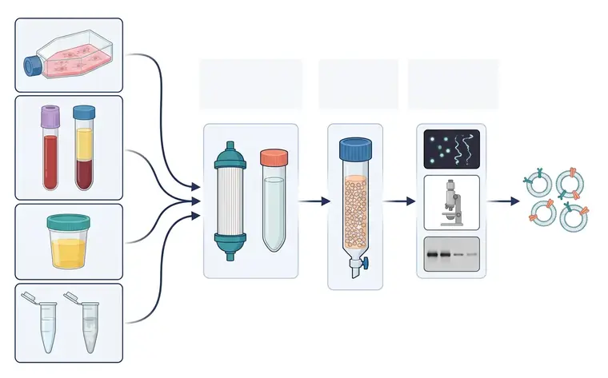
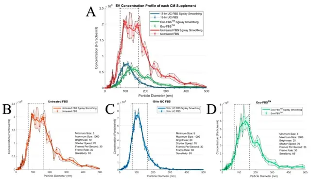

# 标准工作流程（以细胞培养上清为例）

> 摘自 [`文档/指南正文v1.2.md`](../../文档/指南正文v1.2.md)（v1.2.0，最后核验 2026-11-13），文字逐字保留，[n] 编号与 [`验证/参考文献v1.1.json`](../../验证/参考文献v1.1.json) 一致。在线互动版：<https://tuanziding.github.io/ev-isolation-guide/>
>
> 许可：本文文字采用 [CC BY-NC 4.0](https://creativecommons.org/licenses/by-nc/4.0/)；商业用途需事先联系作者获得授权合作（<https://tuanziding.github.io/#contact>）。
>
> **声明**：本页为方法学参考与文献综述，不构成针对任何具体课题的实验方案或结论。文中参数为已发表研究或国际细胞外囊泡学会（ISEV）指南中的报告值或常见范围，具体数值以所用仪器、转子和商品化产品说明书为准，正式实验前应在本实验室样本上小试验证。用于正式研究时，提取方案与质控标准建议预先写入研究方案或预注册。凡标注“【实验室惯例】”或“【估算】”的内容，没有直接的文献测定值支持，仅供参考。

样本质量在收集时就决定了上限：MISEV2023 建议尽早去除细胞，因为细胞破碎会形成类似 EV 的颗粒 [1]。

1. **收集与前处理**：胎牛血清（FBS）含大量 EV，可改变受体细胞表型；18 h 超离（120,000×g）可去除约 95% 含 RNA 的 FBS EV，1.5 h 不够 [32]；也有研究用 100,000×g 18 h [2]。但无论自制还是商品化“去 EV 血清”都会残留 EV，需验证 [1,33]；超离去除效果可能取决于稀释程度 [1]。也可用无血清/限定培养基窗口，但去 EV 血清和无血清培养都可能改变细胞生理和 EV 产生 [1]。应报告细胞身份、接种和收获密度、收获时活率及传代数 [1]。少数死亡细胞产生的 EV 就可能超过健康细胞产生的 EV，因此活率直接影响 EV 亚型构成和数量 [1]；具体活率阈值（如 >90%）无统一标准，属【实验室惯例】。收集窗口 24–48 h 为常见做法【实验室惯例】。
2. **梯度预澄清**：300×g 去细胞 → 2,000×g 去碎片 → 10,000×g 去较大颗粒 [8,9]；全程 4 °C【实验室惯例】。若当天处理不了，应先去除细胞再冻存上清，并报告冻存温度、时长和冻融次数 [1]。
3. **浓缩**：按体积选择——小体积用超滤管或直接 dUC，大体积（如数百毫升以上）用 TFF [4,13]；具体体积分界（如 <30 mL / ≥100 mL）为【实验室惯例】。
4. **纯化与换液**：SEC / 密度梯度 / 免疫捕获按用途选一 [1]；最终换液到实验所需缓冲液，必要时再浓缩。
5. **表征与储存**：测颗粒浓度与粒径、总蛋白，并分别报告绝对颗粒数和蛋白量 [1]；做蛋白标志检测 [1]。分装储存并报告全部储存参数 [1]（储存缓冲液选择见质控清单）。

## 相关图片

点击缩略图查看原图。标“AI 示意图 · 非实验数据”的是帮助理解原理的 AI 生成示意图；标“文献原图 · CC BY 4.0”的转载自原论文，版权归原作者，按其原 CC BY 4.0 许可使用（见 [`文档/图片说明v1.0.md`](../../文档/图片说明v1.0.md)），不属于本仓库的许可范围。

**从样本到表征：EV 研究总流程**（AI 示意图 · 非实验数据）

1. 细胞培养上清；2. 血液 → 血浆；3. 尿液；4. 脑脊液 / 唾液；5. ① 浓缩；6. ② 纯化；7. ③ 表征；8. TFF / 超滤 · 超离；9. SEC；10. NTA；11. 电镜；12. Western blot；13. EV

左侧为常见样本来源：细胞培养瓶、抗凝采血管及离心后的血浆（上层淡黄）、尿杯、脑脊液与唾液管；各样本汇入“浓缩（中空纤维滤柱、超离管）→ 纯化（多孔填料色谱柱）→ 表征（颗粒追踪、电镜、蛋白印迹）”三段流程，最右为脂双层囊泡。

**“去 EV 血清”并不等于“无 EV”：三种培养基的颗粒背景**（文献原图 · CC BY 4.0）

怎么读：（A）三种完全培养基叠加对比（已按稀释倍数校正）：红线为未处理 FBS，蓝线为 18 小时超速离心去 EV 的 FBS，绿线为商品化 Exo-FBS；（B–D）分别为三种培养基的单独测量（稀释 1:1000、1:250、1:333）；虚线框为作者定义的 75–165 nm EV 区间。怎么读：两种“去 EV”血清的颗粒浓度都低于未处理 FBS，但仍能测到明显的颗粒峰——也就是牛源 EV 仍然存在。实操上，应把“只含培养基、不接细胞”的空白培养基按同样流程提取，作为本底对照，从结果中扣除。

> Reproduced from Lehrich BM, Liang Y, Khosravi P, et al., 2018, *Int J Mol Sci* Figure 1, [CC BY 4.0](https://creativecommons.org/licenses/by/4.0/), no changes. DOI: [10.3390/ijms19113538](https://doi.org/10.3390/ijms19113538) · [PMC6275013](https://pmc.ncbi.nlm.nih.gov/articles/PMC6275013/) · 文献 [33]

## 本文引用的参考文献

[1] Welsh JA, Goberdhan DCI, O'Driscoll L, Buzas EI, Blenkiron C, Bussolati B, et al. Minimal information for studies of extracellular vesicles (MISEV2023): From basic to advanced approaches. J Extracell Vesicles. 2024;13:e12404. doi:[10.1002/jev2.12404](https://doi.org/10.1002/jev2.12404). PMID:[38326288](https://pubmed.ncbi.nlm.nih.gov/38326288/); [PMC10850029](https://pmc.ncbi.nlm.nih.gov/articles/PMC10850029/).

[2] Van Deun J, Mestdagh P, Sormunen R, Cocquyt V, Vermaelen K, Vandesompele J, et al. The impact of disparate isolation methods for extracellular vesicles on downstream RNA profiling. J Extracell Vesicles. 2014;3:24858. doi:[10.3402/jev.v3.24858](https://doi.org/10.3402/jev.v3.24858). PMID:[25317274](https://pubmed.ncbi.nlm.nih.gov/25317274/); [PMC4169610](https://pmc.ncbi.nlm.nih.gov/articles/PMC4169610/).

[4] Busatto S, Vilanilam G, Ticer T, Lin WL, Dickson DW, Shapiro S, et al. Tangential Flow Filtration for Highly Efficient Concentration of Extracellular Vesicles from Large Volumes of Fluid. Cells. 2018;7:273. doi:[10.3390/cells7120273](https://doi.org/10.3390/cells7120273). PMID:[30558352](https://pubmed.ncbi.nlm.nih.gov/30558352/); [PMC6315734](https://pmc.ncbi.nlm.nih.gov/articles/PMC6315734/).

[8] Théry C, Amigorena S, Raposo G, Clayton A. Isolation and characterization of exosomes from cell culture supernatants and biological fluids. Curr Protoc Cell Biol. 2006;30:Unit 3.22. doi:[10.1002/0471143030.cb0322s30](https://doi.org/10.1002/0471143030.cb0322s30). PMID:[18228490](https://pubmed.ncbi.nlm.nih.gov/18228490/).

[9] Livshits MA, Khomyakova E, Evtushenko EG, Lazarev VN, Kulemin NA, Semina SE, et al. Isolation of exosomes by differential centrifugation: Theoretical analysis of a commonly used protocol. Sci Rep. 2015;5:17319. doi:[10.1038/srep17319](https://doi.org/10.1038/srep17319). PMID:[26616523](https://pubmed.ncbi.nlm.nih.gov/26616523/); [PMC4663484](https://pmc.ncbi.nlm.nih.gov/articles/PMC4663484/).

[13] Lobb RJ, Becker M, Wen SW, Wong CS, Wiegmans AP, Leimgruber A, et al. Optimized exosome isolation protocol for cell culture supernatant and human plasma. J Extracell Vesicles. 2015;4:27031. doi:[10.3402/jev.v4.27031](https://doi.org/10.3402/jev.v4.27031). PMID:[26194179](https://pubmed.ncbi.nlm.nih.gov/26194179/); [PMC4507751](https://pmc.ncbi.nlm.nih.gov/articles/PMC4507751/).

[32] Shelke GV, Lässer C, Gho YS, Lötvall J. Importance of exosome depletion protocols to eliminate functional and RNA-containing extracellular vesicles from fetal bovine serum. J Extracell Vesicles. 2014;3:24783. doi:[10.3402/jev.v3.24783](https://doi.org/10.3402/jev.v3.24783). PMID:[25317276](https://pubmed.ncbi.nlm.nih.gov/25317276/); [PMC4185091](https://pmc.ncbi.nlm.nih.gov/articles/PMC4185091/).

[33] Lehrich BM, Liang Y, Khosravi P, Federoff HJ, Fiandaca MS. Fetal Bovine Serum-Derived Extracellular Vesicles Persist within Vesicle-Depleted Culture Media. Int J Mol Sci. 2018;19:3538. doi:[10.3390/ijms19113538](https://doi.org/10.3390/ijms19113538). PMID:[30423996](https://pubmed.ncbi.nlm.nih.gov/30423996/); [PMC6275013](https://pmc.ncbi.nlm.nih.gov/articles/PMC6275013/).
