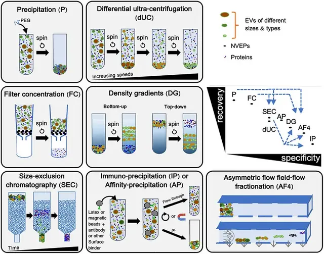
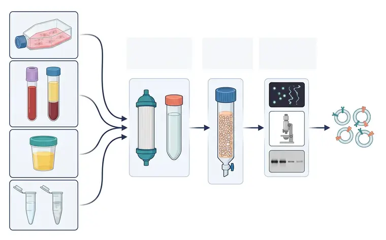

# 横向对比速查

> 摘自 [`文档/指南正文v1.2.md`](../../文档/指南正文v1.2.md)（v1.2.0，最后核验 2026-11-13），文字逐字保留，[n] 编号与 [`验证/参考文献v1.1.json`](../../验证/参考文献v1.1.json) 一致。在线互动版：<https://tuanziding.github.io/ev-isolation-guide/>
>
> 许可：本文文字采用 [CC BY-NC 4.0](https://creativecommons.org/licenses/by-nc/4.0/)；商业用途需事先联系作者获得授权合作（<https://tuanziding.github.io/#contact>）。
>
> **声明**：本页为方法学参考与文献综述，不构成针对任何具体课题的实验方案或结论。文中参数为已发表研究或国际细胞外囊泡学会（ISEV）指南中的报告值或常见范围，具体数值以所用仪器、转子和商品化产品说明书为准，正式实验前应在本实验室样本上小试验证。用于正式研究时，提取方案与质控标准建议预先写入研究方案或预注册。凡标注“【实验室惯例】”或“【估算】”的内容，没有直接的文献测定值支持，仅供参考。

> 评分为基于所引比较研究和 MISEV2023 方法学描述的**定性共识**（同一样本类型内比较），不是测量值；实际表现随样本与操作波动很大——把它当选型地图，不要当绝对指标 [1,5,7,12]。“耗时”一栏为根据所引方案离心/运行时间加上操作时间的【估算】。

| 方法 | 纯度 | 得率 | 耗时【估算】 | 最适合 | 主要依据 |
|---|---|---|---|---|---|
| 差速超速离心 dUC | 中 | 中（血浆研究：单次约 40%，两次约 16%） | 约 4–5 h（离心合计约 3 h 10 min） | 常规制备、文献对照 | [6,8,9,12] |
| 密度梯度 DGUC | 最高 | 低 | 约 1 天（梯度离心 18 h） | 组学、标志物 | [1,2,15] |
| SEC | 较高（脂蛋白除外） | 中高 | 柱上运行通常 <1 h，另加浓缩 | 功能实验、体液纯化 | [3,17,18] |
| TFF / 超滤 | 低（需搭配） | 高 | TFF 约 1 h（200 mL 级） | 大体积浓缩、放大制备 | [1,4,24] |
| 聚合物沉淀 | 最低 | 颗粒数最高（非 EV 特异） | 过夜（≥12 h）+ 约 1 h | 初步筛查 | [12,19,25] |
| 免疫亲和 | 目标亚群特异性高 | 低 | 数小时（依方案） | 特定亚群富集 | [1,26,27] |
| 微流控 / AF4 | 高尺寸分辨率，非 EV 特异 | 回收高但处理量小 | 依平台 | 微量样本分析、分级研究 | [1,5,30] |

## 相关图片

点击缩略图查看原图。标“AI 示意图 · 非实验数据”的是帮助理解原理的 AI 生成示意图；标“文献原图 · CC BY 4.0”的转载自原论文，版权归原作者，按其原 CC BY 4.0 许可使用（见 [`文档/图片说明v1.0.md`](../../文档/图片说明v1.0.md)），不属于本仓库的许可范围。

**MISEV2023：各分离方法在“回收率 vs 特异性”坐标上的位置**（文献原图 · CC BY 4.0）

怎么读：左侧为七类方法的原理小图（沉淀 P、差速超速离心 dUC、过滤浓缩 FC、密度梯度 DG、SEC、免疫/亲和沉淀 IP/AP、非对称流场流分离 AF4），右上为“回收率–特异性”坐标，蓝色虚线箭头表示方法组合后特异性提高。怎么读：越靠左上回收率高但特异性低（如沉淀），越靠右下特异性高但回收率低（如 IP、AF4）；原文特别指出很多“外泌体提取试剂盒”本质是沉淀，得到的是各种细胞外颗粒的混合物，而不是纯外泌体。这是示意图，不是测量数据。

> Reproduced from Welsh JA, Goberdhan DCI, O'Driscoll L, et al., 2024, *J Extracell Vesicles* FIGURE 2, [CC BY 4.0](https://creativecommons.org/licenses/by/4.0/), no changes. DOI: [10.1002/jev2.12404](https://doi.org/10.1002/jev2.12404) · [PMC10850029](https://pmc.ncbi.nlm.nih.gov/articles/PMC10850029/) · 文献 [1]

**从样本到表征：EV 研究总流程**（AI 示意图 · 非实验数据）

1. 细胞培养上清；2. 血液 → 血浆；3. 尿液；4. 脑脊液 / 唾液；5. ① 浓缩；6. ② 纯化；7. ③ 表征；8. TFF / 超滤 · 超离；9. SEC；10. NTA；11. 电镜；12. Western blot；13. EV

左侧为常见样本来源：细胞培养瓶、抗凝采血管及离心后的血浆（上层淡黄）、尿杯、脑脊液与唾液管；各样本汇入“浓缩（中空纤维滤柱、超离管）→ 纯化（多孔填料色谱柱）→ 表征（颗粒追踪、电镜、蛋白印迹）”三段流程，最右为脂双层囊泡。

## 本文引用的参考文献

[1] Welsh JA, Goberdhan DCI, O'Driscoll L, Buzas EI, Blenkiron C, Bussolati B, et al. Minimal information for studies of extracellular vesicles (MISEV2023): From basic to advanced approaches. J Extracell Vesicles. 2024;13:e12404. doi:[10.1002/jev2.12404](https://doi.org/10.1002/jev2.12404). PMID:[38326288](https://pubmed.ncbi.nlm.nih.gov/38326288/); [PMC10850029](https://pmc.ncbi.nlm.nih.gov/articles/PMC10850029/).

[2] Van Deun J, Mestdagh P, Sormunen R, Cocquyt V, Vermaelen K, Vandesompele J, et al. The impact of disparate isolation methods for extracellular vesicles on downstream RNA profiling. J Extracell Vesicles. 2014;3:24858. doi:[10.3402/jev.v3.24858](https://doi.org/10.3402/jev.v3.24858). PMID:[25317274](https://pubmed.ncbi.nlm.nih.gov/25317274/); [PMC4169610](https://pmc.ncbi.nlm.nih.gov/articles/PMC4169610/).

[3] Nordin JZ, Lee Y, Vader P, Mäger I, Johansson HJ, Heusermann W, et al. Ultrafiltration with size-exclusion liquid chromatography for high yield isolation of extracellular vesicles preserving intact biophysical and functional properties. Nanomedicine. 2015;11:879-883. doi:[10.1016/j.nano.2015.01.003](https://doi.org/10.1016/j.nano.2015.01.003). PMID:[25659648](https://pubmed.ncbi.nlm.nih.gov/25659648/).

[4] Busatto S, Vilanilam G, Ticer T, Lin WL, Dickson DW, Shapiro S, et al. Tangential Flow Filtration for Highly Efficient Concentration of Extracellular Vesicles from Large Volumes of Fluid. Cells. 2018;7:273. doi:[10.3390/cells7120273](https://doi.org/10.3390/cells7120273). PMID:[30558352](https://pubmed.ncbi.nlm.nih.gov/30558352/); [PMC6315734](https://pmc.ncbi.nlm.nih.gov/articles/PMC6315734/).

[5] Dong L, Zieren RC, Horie K, Kim CJ, Mallick E, Jing Y, et al. Comprehensive evaluation of methods for small extracellular vesicles separation from human plasma, urine and cell culture medium. J Extracell Vesicles. 2020;10:e12044. doi:[10.1002/jev2.12044](https://doi.org/10.1002/jev2.12044). PMID:[33489012](https://pubmed.ncbi.nlm.nih.gov/33489012/); [PMC7810129](https://pmc.ncbi.nlm.nih.gov/articles/PMC7810129/).

[6] Gardiner C, Di Vizio D, Sahoo S, Théry C, Witwer KW, Wauben M, et al. Techniques used for the isolation and characterization of extracellular vesicles: results of a worldwide survey. J Extracell Vesicles. 2016;5:32945. doi:[10.3402/jev.v5.32945](https://doi.org/10.3402/jev.v5.32945). PMID:[27802845](https://pubmed.ncbi.nlm.nih.gov/27802845/); [PMC5090131](https://pmc.ncbi.nlm.nih.gov/articles/PMC5090131/).

[7] Brennan K, Martin K, FitzGerald SP, O'Sullivan J, Wu Y, Blanco A, et al. A comparison of methods for the isolation and separation of extracellular vesicles from protein and lipid particles in human serum. Sci Rep. 2020;10:1039. doi:[10.1038/s41598-020-57497-7](https://doi.org/10.1038/s41598-020-57497-7). PMID:[31974468](https://pubmed.ncbi.nlm.nih.gov/31974468/); [PMC6978318](https://pmc.ncbi.nlm.nih.gov/articles/PMC6978318/).

[8] Théry C, Amigorena S, Raposo G, Clayton A. Isolation and characterization of exosomes from cell culture supernatants and biological fluids. Curr Protoc Cell Biol. 2006;30:Unit 3.22. doi:[10.1002/0471143030.cb0322s30](https://doi.org/10.1002/0471143030.cb0322s30). PMID:[18228490](https://pubmed.ncbi.nlm.nih.gov/18228490/).

[9] Livshits MA, Khomyakova E, Evtushenko EG, Lazarev VN, Kulemin NA, Semina SE, et al. Isolation of exosomes by differential centrifugation: Theoretical analysis of a commonly used protocol. Sci Rep. 2015;5:17319. doi:[10.1038/srep17319](https://doi.org/10.1038/srep17319). PMID:[26616523](https://pubmed.ncbi.nlm.nih.gov/26616523/); [PMC4663484](https://pmc.ncbi.nlm.nih.gov/articles/PMC4663484/).

[12] Tian Y, Gong M, Hu Y, Liu H, Zhang W, Zhang M, et al. Quality and efficiency assessment of six extracellular vesicle isolation methods by nano-flow cytometry. J Extracell Vesicles. 2020;9:1697028. doi:[10.1080/20013078.2019.1697028](https://doi.org/10.1080/20013078.2019.1697028). PMID:[31839906](https://pubmed.ncbi.nlm.nih.gov/31839906/); [PMC6896440](https://pmc.ncbi.nlm.nih.gov/articles/PMC6896440/).

[15] Jeppesen DK, Fenix AM, Franklin JL, Higginbotham JN, Zhang Q, Zimmerman LJ, et al. Reassessment of Exosome Composition. Cell. 2019;177:428-445.e18. doi:[10.1016/j.cell.2019.02.029](https://doi.org/10.1016/j.cell.2019.02.029). PMID:[30951670](https://pubmed.ncbi.nlm.nih.gov/30951670/); [PMC6664447](https://pmc.ncbi.nlm.nih.gov/articles/PMC6664447/).

[17] Karimi N, Cvjetkovic A, Jang SC, Crescitelli R, Hosseinpour Feizi MA, Nieuwland R, et al. Detailed analysis of the plasma extracellular vesicle proteome after separation from lipoproteins. Cell Mol Life Sci. 2018;75:2873-2886. doi:[10.1007/s00018-018-2773-4](https://doi.org/10.1007/s00018-018-2773-4). PMID:[29441425](https://pubmed.ncbi.nlm.nih.gov/29441425/); [PMC6021463](https://pmc.ncbi.nlm.nih.gov/articles/PMC6021463/).

[18] Böing AN, van der Pol E, Grootemaat AE, Coumans FA, Sturk A, Nieuwland R. Single-step isolation of extracellular vesicles by size-exclusion chromatography. J Extracell Vesicles. 2014;3:23430. doi:[10.3402/jev.v3.23430](https://doi.org/10.3402/jev.v3.23430). PMID:[25279113](https://pubmed.ncbi.nlm.nih.gov/25279113/); [PMC4159761](https://pmc.ncbi.nlm.nih.gov/articles/PMC4159761/).

[19] Gámez-Valero A, Monguió-Tortajada M, Carreras-Planella L, Franquesa Ml, Beyer K, Borràs FE. Size-Exclusion Chromatography-based isolation minimally alters Extracellular Vesicles' characteristics compared to precipitating agents. Sci Rep. 2016;6:33641. doi:[10.1038/srep33641](https://doi.org/10.1038/srep33641). PMID:[27640641](https://pubmed.ncbi.nlm.nih.gov/27640641/); [PMC5027519](https://pmc.ncbi.nlm.nih.gov/articles/PMC5027519/).

[24] Haraszti RA, Miller R, Stoppato M, Sere YY, Coles A, Didiot MC, et al. Exosomes Produced from 3D Cultures of MSCs by Tangential Flow Filtration Show Higher Yield and Improved Activity. Mol Ther. 2018;26:2838-2847. doi:[10.1016/j.ymthe.2018.09.015](https://doi.org/10.1016/j.ymthe.2018.09.015). PMID:[30341012](https://pubmed.ncbi.nlm.nih.gov/30341012/); [PMC6277553](https://pmc.ncbi.nlm.nih.gov/articles/PMC6277553/).

[25] Rider MA, Hurwitz SN, Meckes DG Jr. ExtraPEG: A Polyethylene Glycol-Based Method for Enrichment of Extracellular Vesicles. Sci Rep. 2016;6:23978. doi:[10.1038/srep23978](https://doi.org/10.1038/srep23978). PMID:[27068479](https://pubmed.ncbi.nlm.nih.gov/27068479/); [PMC4828635](https://pmc.ncbi.nlm.nih.gov/articles/PMC4828635/).

[26] Kowal J, Arras G, Colombo M, Jouve M, Morath JP, Primdal-Bengtson B, et al. Proteomic comparison defines novel markers to characterize heterogeneous populations of extracellular vesicle subtypes. Proc Natl Acad Sci U S A. 2016;113:E968-E977. doi:[10.1073/pnas.1521230113](https://doi.org/10.1073/pnas.1521230113). PMID:[26858453](https://pubmed.ncbi.nlm.nih.gov/26858453/); [PMC4776515](https://pmc.ncbi.nlm.nih.gov/articles/PMC4776515/).

[27] Tauro BJ, Greening DW, Mathias RA, Ji H, Mathivanan S, Scott AM, et al. Comparison of ultracentrifugation, density gradient separation, and immunoaffinity capture methods for isolating human colon cancer cell line LIM1863-derived exosomes. Methods. 2012;56:293-304. doi:[10.1016/j.ymeth.2012.01.002](https://doi.org/10.1016/j.ymeth.2012.01.002). PMID:[22285593](https://pubmed.ncbi.nlm.nih.gov/22285593/).

[30] Zhang H, Freitas D, Kim HS, Fabijanic K, Li Z, Chen H, et al. Identification of distinct nanoparticles and subsets of extracellular vesicles by asymmetric flow field-flow fractionation. Nat Cell Biol. 2018;20:332-343. doi:[10.1038/s41556-018-0040-4](https://doi.org/10.1038/s41556-018-0040-4). PMID:[29459780](https://pubmed.ncbi.nlm.nih.gov/29459780/); [PMC5931706](https://pmc.ncbi.nlm.nih.gov/articles/PMC5931706/).
