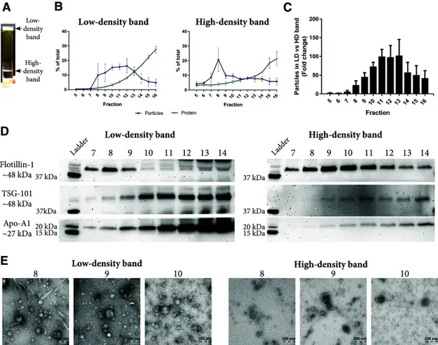

# 推荐的组合思路

> 摘自 [`文档/指南正文v1.2.md`](../../文档/指南正文v1.2.md)（v1.2.0，最后核验 2026-11-13），文字逐字保留，[n] 编号与 [`验证/参考文献v1.1.json`](../../验证/参考文献v1.1.json) 一致。在线互动版：<https://tuanziding.github.io/ev-isolation-guide/>
>
> 许可：本文文字采用 [CC BY-NC 4.0](https://creativecommons.org/licenses/by-nc/4.0/)；商业用途需事先联系作者获得授权合作（<https://tuanziding.github.io/#contact>）。
>
> **声明**：本页为方法学参考与文献综述，不构成针对任何具体课题的实验方案或结论。文中参数为已发表研究或国际细胞外囊泡学会（ISEV）指南中的报告值或常见范围，具体数值以所用仪器、转子和商品化产品说明书为准，正式实验前应在本实验室样本上小试验证。用于正式研究时，提取方案与质控标准建议预先写入研究方案或预注册。凡标注“【实验室惯例】”或“【估算】”的内容，没有直接的文献测定值支持，仅供参考。

## 为什么常用“两步法”

每一步通常只按一种性质分离（沉降、密度、尺寸、电荷/抗原），而杂质往往在某一维度上与 EV 重叠；按不同性质依次组合可提高特异性 [1]。

- **浓缩步解决体积问题**：TFF / 超滤 / 离心 [1]。
- **纯化步解决杂质问题**：SEC 去可溶蛋白和 HDL [18]；密度梯度去除与 EV 大小重叠但密度不同的脂蛋白（VLDL、LDL、乳糜微粒）[1,17]；免疫捕获选择亚群 [26]。
- **功能实验（细胞/动物给药）**：超滤/TFF 浓缩 + SEC 是有文献支持的、兼顾得率与生物物理性质的组合 [3,4,23]。
- **组学与标志物**：dUC + 密度梯度 [2,15]，或 SEC 与密度分离联用（血液样本）[17]，纯度优先、得率让步。

## 相关图片

点击缩略图查看原图。标“AI 示意图 · 非实验数据”的是帮助理解原理的 AI 生成示意图；标“文献原图 · CC BY 4.0”的转载自原论文，版权归原作者，按其原 CC BY 4.0 许可使用（见 [`文档/图片说明v1.0.md`](../../文档/图片说明v1.0.md)），不属于本仓库的许可范围。

**血浆“两步法”：密度垫 + SEC 把 EV 与脂蛋白分开**（文献原图 · CC BY 4.0）

怎么读：（a）血浆加在碘克沙醇密度垫上超速离心后出现两条带：低密度带（<1.025 g/cm³）与高密度带（约 1.06–1.16 g/cm³）；（b）两条带分别再过 SEC，测各组分颗粒与蛋白；（c）低密度带与高密度带的颗粒数倍数比较；（d）Western blot：EV 标志 flotillin-1、TSG-101 与 HDL 标志 Apo-A1 在两条带各组分中的分布；（e）负染 TEM。怎么读：原文用这一组合来把 EV 从脂蛋白和血浆蛋白中分出来；判读时看高密度带的 SEC 组分中 TSG-101 等 EV 标志物是否保留、Apo-A1 等脂蛋白信号是否相对减少——这比单用一种方法更接近“干净”的血浆 EV。具体结论请以原文结果部分为准。

> Reproduced from Karimi N, Cvjetkovic A, Jang SC, et al., 2018, *Cell Mol Life Sci* Fig. 4, [CC BY 4.0](https://creativecommons.org/licenses/by/4.0/), no changes. DOI: [10.1007/s00018-018-2773-4](https://doi.org/10.1007/s00018-018-2773-4) · [PMC6021463](https://pmc.ncbi.nlm.nih.gov/articles/PMC6021463/) · 文献 [17]

## 本文引用的参考文献

[1] Welsh JA, Goberdhan DCI, O'Driscoll L, Buzas EI, Blenkiron C, Bussolati B, et al. Minimal information for studies of extracellular vesicles (MISEV2023): From basic to advanced approaches. J Extracell Vesicles. 2024;13:e12404. doi:[10.1002/jev2.12404](https://doi.org/10.1002/jev2.12404). PMID:[38326288](https://pubmed.ncbi.nlm.nih.gov/38326288/); [PMC10850029](https://pmc.ncbi.nlm.nih.gov/articles/PMC10850029/).

[2] Van Deun J, Mestdagh P, Sormunen R, Cocquyt V, Vermaelen K, Vandesompele J, et al. The impact of disparate isolation methods for extracellular vesicles on downstream RNA profiling. J Extracell Vesicles. 2014;3:24858. doi:[10.3402/jev.v3.24858](https://doi.org/10.3402/jev.v3.24858). PMID:[25317274](https://pubmed.ncbi.nlm.nih.gov/25317274/); [PMC4169610](https://pmc.ncbi.nlm.nih.gov/articles/PMC4169610/).

[3] Nordin JZ, Lee Y, Vader P, Mäger I, Johansson HJ, Heusermann W, et al. Ultrafiltration with size-exclusion liquid chromatography for high yield isolation of extracellular vesicles preserving intact biophysical and functional properties. Nanomedicine. 2015;11:879-883. doi:[10.1016/j.nano.2015.01.003](https://doi.org/10.1016/j.nano.2015.01.003). PMID:[25659648](https://pubmed.ncbi.nlm.nih.gov/25659648/).

[4] Busatto S, Vilanilam G, Ticer T, Lin WL, Dickson DW, Shapiro S, et al. Tangential Flow Filtration for Highly Efficient Concentration of Extracellular Vesicles from Large Volumes of Fluid. Cells. 2018;7:273. doi:[10.3390/cells7120273](https://doi.org/10.3390/cells7120273). PMID:[30558352](https://pubmed.ncbi.nlm.nih.gov/30558352/); [PMC6315734](https://pmc.ncbi.nlm.nih.gov/articles/PMC6315734/).

[15] Jeppesen DK, Fenix AM, Franklin JL, Higginbotham JN, Zhang Q, Zimmerman LJ, et al. Reassessment of Exosome Composition. Cell. 2019;177:428-445.e18. doi:[10.1016/j.cell.2019.02.029](https://doi.org/10.1016/j.cell.2019.02.029). PMID:[30951670](https://pubmed.ncbi.nlm.nih.gov/30951670/); [PMC6664447](https://pmc.ncbi.nlm.nih.gov/articles/PMC6664447/).

[17] Karimi N, Cvjetkovic A, Jang SC, Crescitelli R, Hosseinpour Feizi MA, Nieuwland R, et al. Detailed analysis of the plasma extracellular vesicle proteome after separation from lipoproteins. Cell Mol Life Sci. 2018;75:2873-2886. doi:[10.1007/s00018-018-2773-4](https://doi.org/10.1007/s00018-018-2773-4). PMID:[29441425](https://pubmed.ncbi.nlm.nih.gov/29441425/); [PMC6021463](https://pmc.ncbi.nlm.nih.gov/articles/PMC6021463/).

[18] Böing AN, van der Pol E, Grootemaat AE, Coumans FA, Sturk A, Nieuwland R. Single-step isolation of extracellular vesicles by size-exclusion chromatography. J Extracell Vesicles. 2014;3:23430. doi:[10.3402/jev.v3.23430](https://doi.org/10.3402/jev.v3.23430). PMID:[25279113](https://pubmed.ncbi.nlm.nih.gov/25279113/); [PMC4159761](https://pmc.ncbi.nlm.nih.gov/articles/PMC4159761/).

[23] Benedikter BJ, Bouwman FG, Vajen T, Heinzmann ACA, Grauls G, Mariman EC, et al. Ultrafiltration combined with size exclusion chromatography efficiently isolates extracellular vesicles from cell culture media for compositional and functional studies. Sci Rep. 2017;7:15297. doi:[10.1038/s41598-017-15717-7](https://doi.org/10.1038/s41598-017-15717-7). PMID:[29127410](https://pubmed.ncbi.nlm.nih.gov/29127410/); [PMC5681555](https://pmc.ncbi.nlm.nih.gov/articles/PMC5681555/).

[26] Kowal J, Arras G, Colombo M, Jouve M, Morath JP, Primdal-Bengtson B, et al. Proteomic comparison defines novel markers to characterize heterogeneous populations of extracellular vesicle subtypes. Proc Natl Acad Sci U S A. 2016;113:E968-E977. doi:[10.1073/pnas.1521230113](https://doi.org/10.1073/pnas.1521230113). PMID:[26858453](https://pubmed.ncbi.nlm.nih.gov/26858453/); [PMC4776515](https://pmc.ncbi.nlm.nih.gov/articles/PMC4776515/).
