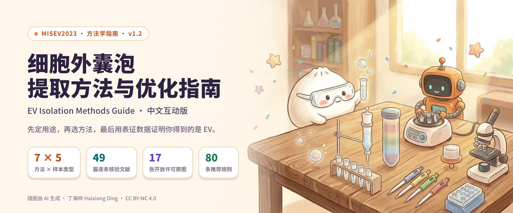
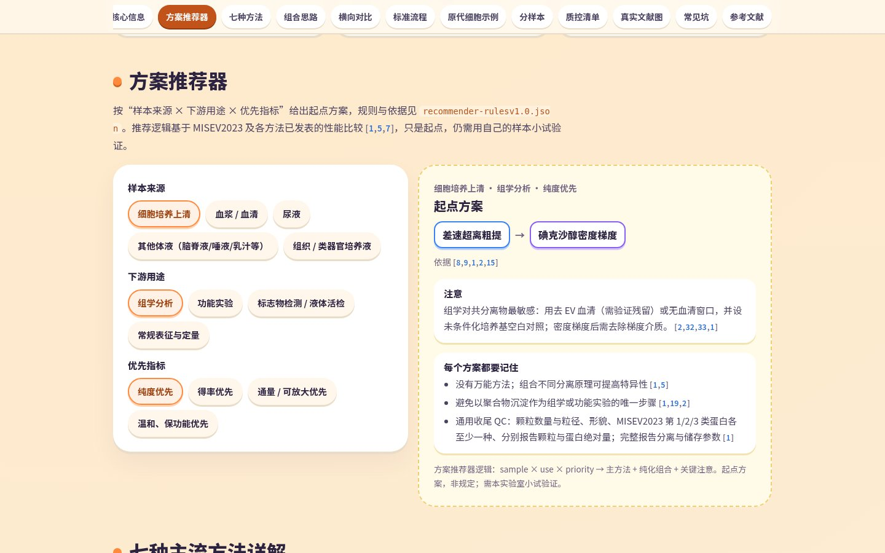
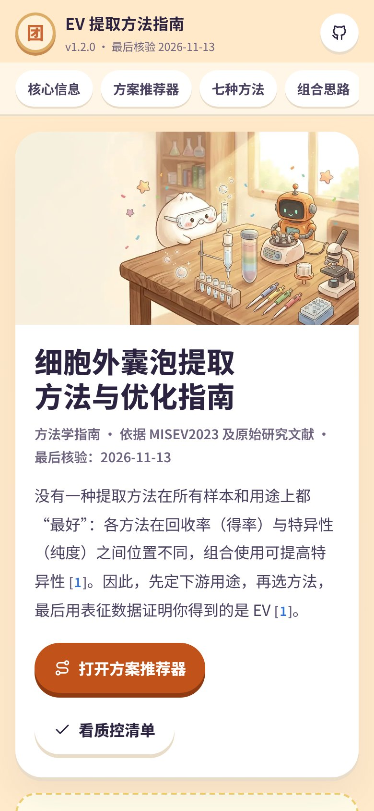
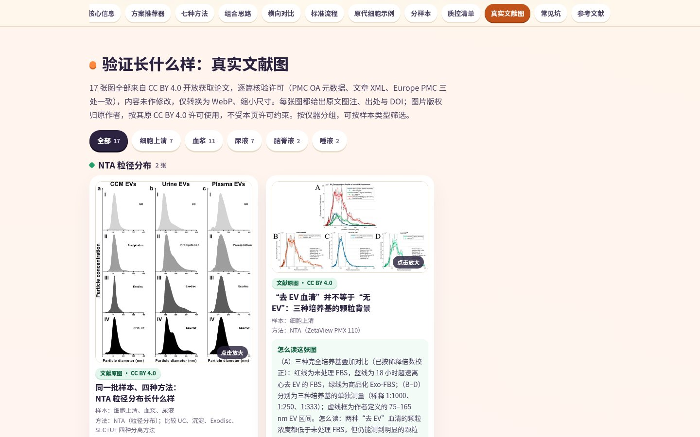
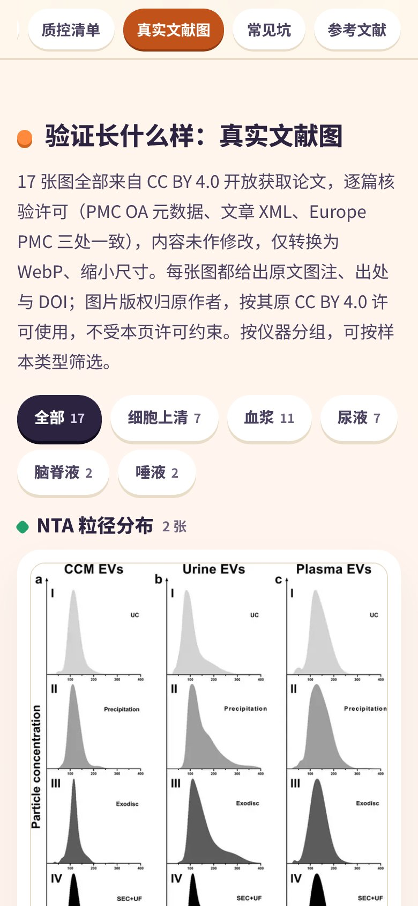

# EV Isolation Methods Guide · English Guide

**Decide the downstream use first, pick the method second, and prove with characterisation data that what you have is EVs.**

An interactive, Chinese-language guide to isolating extracellular vesicles (EVs), version 1.2.0 (last verified 2026-11-13).

[▶ Read online](https://tuanziding.github.io/ev-isolation-guide/) · [aiai-academy.com edition](https://aiai-academy.com/lessons/ev-isolation-guidev1.0.html) · [简体中文](../README.md)



## What it covers

- **Seven methods**: differential ultracentrifugation, density-gradient ultracentrifugation, size-exclusion chromatography, ultrafiltration / tangential-flow filtration, polymer precipitation, immunoaffinity capture, microfluidics and asymmetric-flow field-flow fractionation. Each has its principle, typical parameters, strengths, limits, optimisation points and a qualitative rating (consensus, not measurement).
- **Recommender**: a starting route for **sample type × downstream use × priority** (5 × 4 × 4 = 80 rules, each with references). The same rules drive the web page and `示例/推荐示例v1.0.py`.
- **QC checklist** based on MISEV2023, plus per-sample notes (cell culture media, plasma/serum, urine, CSF/saliva, tissue) and common pitfalls.
- **49 references**, each checked against PubMed and Crossref; 106 factual statements graded against the primary literature (44 supported, 52 rewritten, 10 removed or labelled).
- **Figures**: 17 figures reproduced unchanged from CC BY 4.0 open-access articles, with attribution, and 12 AI-generated schematics labelled “AI 示意图 · 非实验数据” (AI schematic, not experimental data).

## Showcase

| Desktop | Mobile |
| --- | --- |
| [](https://tuanziding.github.io/ev-isolation-guide/#rec) | [](https://tuanziding.github.io/ev-isolation-guide/) |
| [](https://tuanziding.github.io/ev-isolation-guide/#realfigs) | [](https://tuanziding.github.io/ev-isolation-guide/#realfigs) |

Real Chromium screenshots of the v1.2.0 page (desktop 1440 px, mobile 390 px).

## Repository layout

| Folder | Contents |
| --- | --- |
| `index.html` + `assets/` | The interactive page (system fonts, no external CDN, works offline and in print) |
| `文档/` (docs) | `指南正文v1.2.md` (full text, single source of truth), `方法/` (per-method SOPs and topic notes), `质控清单v1.2.md` (QC checklist), `图片说明v1.0.md` (figure licences and attributions), cover and screenshots |
| `图片/` (figures) | `文献原图/` (17 literature figures + metadata JSON), `示意图/` (12 AI schematics + label coordinates) |
| `示例/` (examples) | Recommender rules JSON, a command-line example and its real output |
| `验证/` (verification) | `项目检查v1.0.py` (offline check run by GitHub Actions), references JSON/BibTeX, claim grading, audit report |
| `工具/` (tools) | Page and Markdown builders, headless browser check |

```sh
python3 -m http.server 8000                       # open http://localhost:8000
python3 示例/推荐示例v1.0.py plasma omics purity    # recommender on the command line
python3 验证/项目检查v1.0.py                         # links, citations, figure licences, licence wording
```

## Licence

For **non-commercial** use only.

- **Author's original content** (text, data, checklists, verification records, AI schematics, mascot illustrations, cover, screenshots): [CC BY-NC 4.0](https://creativecommons.org/licenses/by-nc/4.0/). Full text: [`LICENSES/CC-BY-NC-4.0.txt`](../LICENSES/CC-BY-NC-4.0.txt).
- **Code** (page markup and scripts, CSS, JS, Python tools, workflow): [PolyForm Noncommercial 1.0.0](https://polyformproject.org/licenses/noncommercial/1.0.0/). Full text: [`LICENSES/PolyForm-Noncommercial-1.0.0.md`](../LICENSES/PolyForm-Noncommercial-1.0.0.md).
- **Third-party literature figures** (`图片/文献原图/fig-*.webp`, 17 files) are **not** covered by either licence. They remain the work of their original authors under their original CC BY 4.0 licences; reuse them with the attribution lines in [`图片说明v1.0.md`](图片说明v1.0.md).

### Commercial use

**Commercial use requires prior permission; contact the author** (商业用途需事先联系作者获得授权合作): [https://tuanziding.github.io/#contact](https://tuanziding.github.io/#contact)

## Disclaimer

A methods reference and literature review, not a protocol or conclusion for any specific project. Parameters are values reported in published studies or ISEV guidance; follow the manuals of your own instruments, rotors and products, and pilot-test on your own samples first.

## How to cite

> Ding H. Extracellular Vesicle Isolation Methods: An Interactive Chinese Guide (细胞外囊泡提取方法与优化指南). Version 1.2.0. 2026-11-13. https://github.com/TUANZIDING/ev-isolation-guide

Please also cite the primary studies you rely on.
