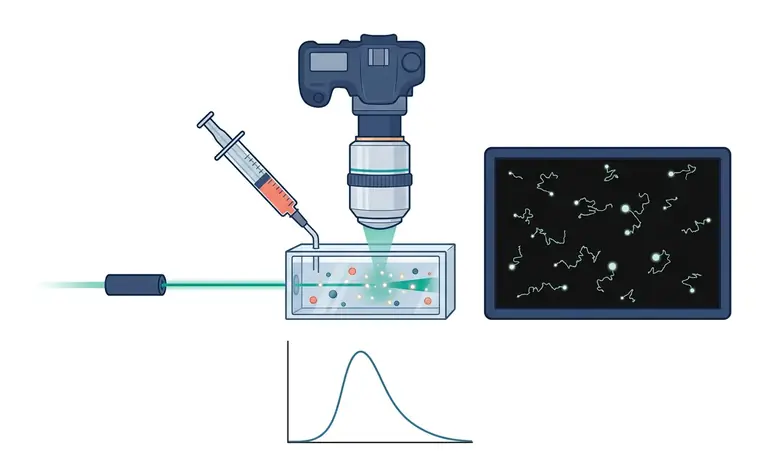
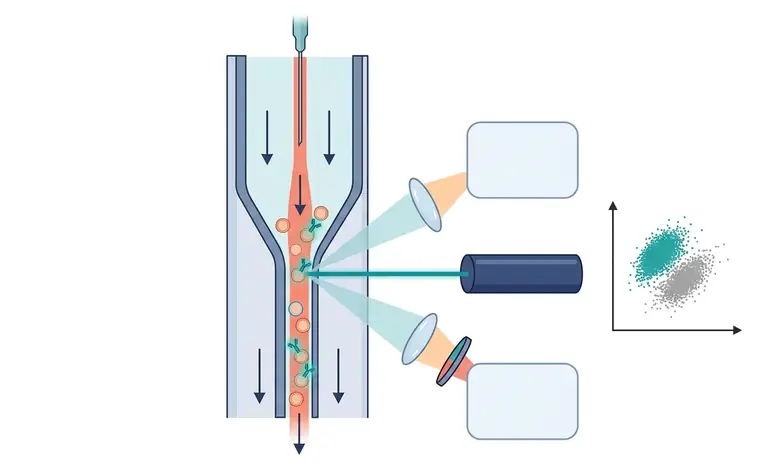
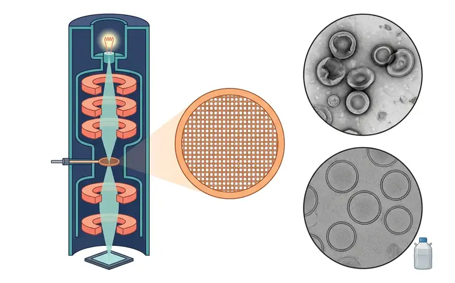
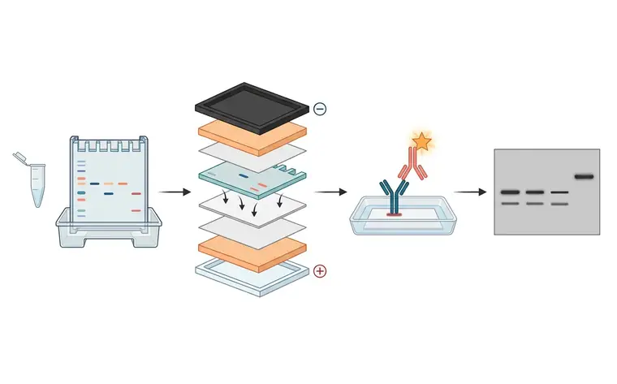
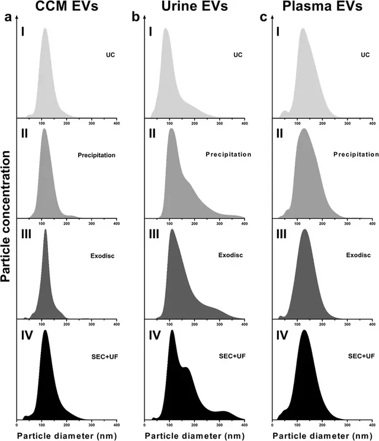
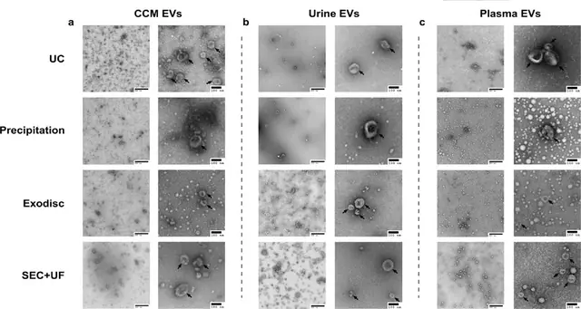
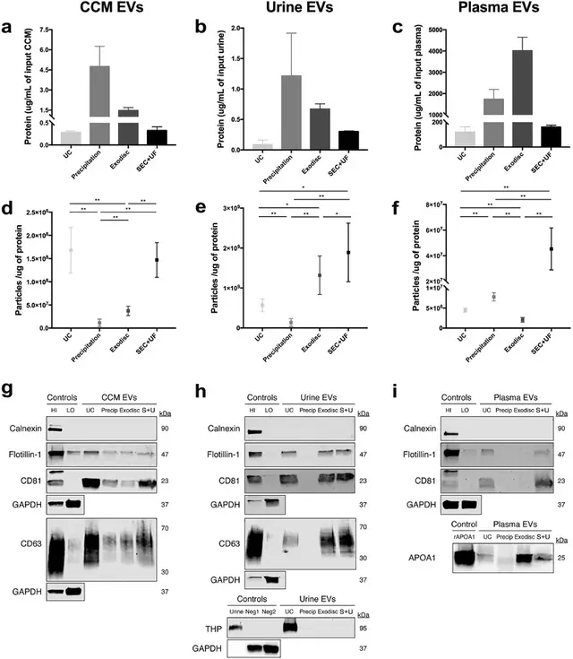

# 质控清单（依据 MISEV2023）

> 摘自 [`文档/指南正文v1.2.md`](../文档/指南正文v1.2.md)（v1.2.0，最后核验 2026-11-13），文字逐字保留，[n] 编号与 [`验证/参考文献v1.1.json`](../验证/参考文献v1.1.json) 一致。在线互动版：<https://tuanziding.github.io/ev-isolation-guide/>
>
> 许可：本文文字采用 [CC BY-NC 4.0](https://creativecommons.org/licenses/by-nc/4.0/)；商业用途需事先联系作者获得授权合作（<https://tuanziding.github.io/#contact>）。
>
> **声明**：本页为方法学参考与文献综述，不构成针对任何具体课题的实验方案或结论。文中参数为已发表研究或国际细胞外囊泡学会（ISEV）指南中的报告值或常见范围，具体数值以所用仪器、转子和商品化产品说明书为准，正式实验前应在本实验室样本上小试验证。用于正式研究时，提取方案与质控标准建议预先写入研究方案或预注册。凡标注“【实验室惯例】”或“【估算】”的内容，没有直接的文献测定值支持，仅供参考。

提取做完不等于拿到 EV。MISEV2023 并不规定某一种必须使用的技术或标志物 [1]，但要求用互补证据支持“EV”的结论；缺项时如实说明，不要用单一颗粒计数结果宣称“提取成功”。

### 表征

- [ ] **颗粒数量与大小**：用 NTA、TRPS、纳米流式等方法报告粒径分布与颗粒浓度，并报告仪器设置和检测下限 [1]。
- [ ] **形貌**：TEM、冷冻电镜等成像；干燥条件下 EV 可能形成“杯状”伪影，水合条件下（如冷冻电镜）不出现 [1]。TEM 图像受操作者选图影响：操作者挑选的图像质量往往高于在预定位置随机取得的图像，后者更能反映样本差异 [40]。
- [ ] **蛋白标志（更正）**：MISEV2023 要求至少分析第 1、2、3 类蛋白各一种：第 1 类为跨膜或 GPI 锚定蛋白（如 CD9、CD63、CD81），第 2 类为胞质蛋白（如 TSG101、ALIX、syntenin），第 3 类为非 EV 共分离结构的主要成分，作为纯度对照（如脂蛋白 ApoA1/ApoB、白蛋白、尿中的 THP）[1]。**原稿“至少 3 个阳性标志”来自 MISEV2014，MISEV2018 已更新** [41]。
- [ ] **细胞内区室蛋白**：calnexin、GM130 等属第 4 类，在 MISEV2023 中为**可选**项，因为它们可能存在于某些 EV 亚型中 [1]；MISEV2018 则要求在宣称研究小 EV 时检测第 4 类 [41]。更宜报告“相对细胞裂解物的耗竭程度”，而不是简单的有/无 [41]。

### 纯度与报告指标

- [ ] **颗粒/蛋白比**：颗粒数 ÷ 蛋白量是常用的纯度估计 [42]；原作者提出 >3×10¹⁰ 颗粒/µg 为高纯度，2×10⁹–2×10¹⁰ 为低纯度，<1.5×10⁹ 为不纯（基于其实验室数据）[42]。该比值依赖仪器检测下限，若报告比值，应同时分别报告颗粒和蛋白的绝对浓度 [1]，也不能替代标志蛋白证据。
- [ ] **回收与特异性**：报告样本投入量与各步骤参数；免疫捕获等方法应定量下拉与流穿以评估效率 [1]。
- [ ] **方法报告**：离心报告转子、rpm、时间、温度、加减速 [1]；SEC 报告填料、柱尺寸、上样量、空体积和收集级分 [1]；过滤/TFF 报告膜类型与截留值 [1]。“100,000×g 离心”这种写法无法复现。可将方法上传 EV-TRACK 知识库以提高透明度 [43]。
- [ ] **储存（更正）**：MISEV2023 指出冻融影响的证据不一致，建议避免反复冻融或评估其影响，并报告全部储存参数 [1]。−80 °C 储存会随时间降低 EV 浓度和纯度 [44]；单纯 PBS 中储存或稀释 EV 回收率可大幅下降，含白蛋白和海藻糖的 PBS（PBS-HAT）稳定性更好 [45]。原稿“PBS 分装、冻融 ≤1 次”的硬性规定无统一依据，已改为上述表述。
- [ ] **用词规范**：除非能证明内体来源，不宜称“外泌体（exosome）”，而应使用“EV”或操作性术语 [1]；“小 EV”常被描述为 <200 nm，但并无严格的大小界限共识，测得的直径也取决于表征方法 [1]。

## 相关图片

点击缩略图查看原图。标“AI 示意图 · 非实验数据”的是帮助理解原理的 AI 生成示意图；标“文献原图 · CC BY 4.0”的转载自原论文，版权归原作者，按其原 CC BY 4.0 许可使用（见 [`文档/图片说明v1.0.md`](../文档/图片说明v1.0.md)），不属于本仓库的许可范围。

**纳米颗粒追踪分析（NTA）**（AI 示意图 · 非实验数据）

1. 激光；2. 样品池；3. 显微物镜；4. 相机；5. 注射器进样；6. 散射光点的布朗运动轨迹；7. 粒径分布

样本经注射器注入样品池，激光束水平穿过液体，颗粒散射光形成亮点；上方显微物镜连接相机录像。右侧画面显示每个亮点的布朗运动轨迹，软件据扩散速度推算粒径并计数，下方为粒径分布曲线示意。

**纳米流式（nFCM）**（AI 示意图 · 非实验数据）

1. 进样针；2. 鞘液；3. 单颗粒芯流；4. 激光；5. 侧向散射检测器；6. 荧光检测器；7. 滤光片；8. 荧光阳性群；9. 阴性群

鞘液流体动力学聚焦把样本流压成极细的芯流，EV 逐个通过激光照射点；部分 EV 带荧光抗体标记。侧向散射光与荧光分别经透镜（荧光再经滤光片）进入两个检测器，右侧散点图中荧光阳性与阴性颗粒形成两群，可做单颗粒亚群分析。

**透射电镜（TEM）与冷冻电镜**（AI 示意图 · 非实验数据）

1. 电子枪；2. 电磁透镜；3. 样品杆与铜网；4. 探测器；5. 铜网；6. 负染 TEM：杯状伪影；7. 冷冻电镜：球形、双层膜；8. 液氮

左：透射电镜镜筒剖面，电子枪发射的电子束经多级电磁透镜会聚，穿过载样铜网，到达底部探测器。中：铜网放大。右上：负染干燥样本中 EV 呈“杯状”塌陷伪影；右下：冷冻电镜在玻璃态冰中显示球形、双层膜清晰的囊泡，无杯状伪影。

**Western blot 工作流程**（AI 示意图 · 非实验数据）

1. SDS-PAGE；2. 湿转三明治；3. 负极；4. 正极；5. 一抗 / 酶标二抗；6. EV 泳道；7. 细胞裂解物

依次为：EV 裂解液上样做 SDS-PAGE 电泳；湿转“三明治”（海绵—滤纸—凝胶—膜—滤纸—海绵）中蛋白从凝胶向正极转移到膜上；膜上一抗结合目标蛋白、酶标二抗放大信号；显影后的条带，最右泳道（细胞裂解物参照）出现 EV 泳道没有的条带，示意细胞内区室蛋白在 EV 中耗竭。

**同一批样本、四种方法：NTA 粒径分布长什么样**（文献原图 · CC BY 4.0）

怎么读：这张图把细胞培养上清、尿液、血浆三类样本分别用超速离心（UC）、沉淀、Exodisc、SEC+超滤（SEC+UF）分离后，用 NTA 测得的粒径分布并排放在一起（每列一种样本，每行一种方法）。怎么读：横轴是颗粒直径（nm），纵轴是颗粒浓度；作者把每张图的峰高都调到量程的 95%，所以只能比较“形状”（峰位置、峰宽、拖尾），不能直接比较高低。一般认为小 EV 制备的主峰落在约 100–150 nm 附近且拖尾有限；尿液列可见部分方法出现更宽的肩峰和拖尾。注意：NTA 只数“颗粒”，蛋白聚集体、脂蛋白同样会被计入，单看粒径分布不能证明纯度，需与蛋白定量、Western blot 合看。

> Reproduced from Dong L, Zieren RC, Horie K, et al., 2020, *J Extracell Vesicles* Figure 2, [CC BY 4.0](https://creativecommons.org/licenses/by/4.0/), no changes. DOI: [10.1002/jev2.12044](https://doi.org/10.1002/jev2.12044) · [PMC7810129](https://pmc.ncbi.nlm.nih.gov/articles/PMC7810129/) · 文献 [5]

**负染 TEM：三类样本、四种方法下的 EV 形貌**（文献原图 · CC BY 4.0）

怎么读：每类样本左侧为低倍（标尺 500 nm）、右侧为高倍（标尺 100 nm）负染 TEM 图，黑色箭头标出作者认为符合 EV 形态标准的颗粒。怎么读：负染 TEM 下 EV 常呈“杯状”（这是干燥制样造成的伪影，不是天然形态）；低倍图用来判断背景是否“干净”——背景中大量无膜的电子致密小点或成团物质，提示蛋白/脂蛋白等非 EV 成分。TEM 只能证明“有囊泡”，不能定量纯度，且操作者挑选的视野往往好于随机视野，建议同时报告低倍全景图。

> Reproduced from Dong L, Zieren RC, Horie K, et al., 2020, *J Extracell Vesicles* Figure 5, [CC BY 4.0](https://creativecommons.org/licenses/by/4.0/), no changes. DOI: [10.1002/jev2.12044](https://doi.org/10.1002/jev2.12044) · [PMC7810129](https://pmc.ncbi.nlm.nih.gov/articles/PMC7810129/) · 文献 [5]

**纯度怎么看：颗粒/蛋白比 + 阳性与阴性标志物 Western blot**（文献原图 · CC BY 4.0）

怎么读：上排（a–c）为各方法所得制备物的蛋白量，中排（d–f）为颗粒/蛋白比，下排（g–i）为 Western blot：EV 阳性标志物 flotillin-1、CD63、CD81；细胞内阴性对照 calnexin；尿液中另检测 Tamm-Horsfall 蛋白（THP，尿调素），血浆中另检测载脂蛋白 APOA1（HDL 标志）。怎么读：“好”的结果是 EV 标志物条带清楚、calnexin 在 EV 泳道缺失（只在细胞膜组分对照 HI 中出现）、样本特异性污染物（THP、APOA1）弱或缺失，同时颗粒/蛋白比较高；沉淀类方法蛋白量高、颗粒/蛋白比低，是蛋白共沉淀的典型表现。图中可见尿液 THP 条带主要出现在 UC 泳道，血浆 APOA1 在多种方法泳道中均可见（请以原文统计为准）。

> Reproduced from Dong L, Zieren RC, Horie K, et al., 2020, *J Extracell Vesicles* Figure 6, [CC BY 4.0](https://creativecommons.org/licenses/by/4.0/), no changes. DOI: [10.1002/jev2.12044](https://doi.org/10.1002/jev2.12044) · [PMC7810129](https://pmc.ncbi.nlm.nih.gov/articles/PMC7810129/) · 文献 [5]

## 本文引用的参考文献

[1] Welsh JA, Goberdhan DCI, O'Driscoll L, Buzas EI, Blenkiron C, Bussolati B, et al. Minimal information for studies of extracellular vesicles (MISEV2023): From basic to advanced approaches. J Extracell Vesicles. 2024;13:e12404. doi:[10.1002/jev2.12404](https://doi.org/10.1002/jev2.12404). PMID:[38326288](https://pubmed.ncbi.nlm.nih.gov/38326288/); [PMC10850029](https://pmc.ncbi.nlm.nih.gov/articles/PMC10850029/).

[5] Dong L, Zieren RC, Horie K, Kim CJ, Mallick E, Jing Y, et al. Comprehensive evaluation of methods for small extracellular vesicles separation from human plasma, urine and cell culture medium. J Extracell Vesicles. 2020;10:e12044. doi:[10.1002/jev2.12044](https://doi.org/10.1002/jev2.12044). PMID:[33489012](https://pubmed.ncbi.nlm.nih.gov/33489012/); [PMC7810129](https://pmc.ncbi.nlm.nih.gov/articles/PMC7810129/).

[40] Rikkert LG, Nieuwland R, Terstappen LWMM, Coumans FAW. Quality of extracellular vesicle images by transmission electron microscopy is operator and protocol dependent. J Extracell Vesicles. 2019;8:1555419. doi:[10.1080/20013078.2018.1555419](https://doi.org/10.1080/20013078.2018.1555419). PMID:[30651939](https://pubmed.ncbi.nlm.nih.gov/30651939/); [PMC6327933](https://pmc.ncbi.nlm.nih.gov/articles/PMC6327933/).

[41] Théry C, Witwer KW, Aikawa E, Alcaraz MJ, Anderson JD, Andriantsitohaina R, et al. Minimal information for studies of extracellular vesicles 2018 (MISEV2018): a position statement of the International Society for Extracellular Vesicles and update of the MISEV2014 guidelines. J Extracell Vesicles. 2018;7:1535750. doi:[10.1080/20013078.2018.1535750](https://doi.org/10.1080/20013078.2018.1535750). PMID:[30637094](https://pubmed.ncbi.nlm.nih.gov/30637094/); [PMC6322352](https://pmc.ncbi.nlm.nih.gov/articles/PMC6322352/).

[42] Webber J, Clayton A. How pure are your vesicles?. J Extracell Vesicles. 2013;2:19861. doi:[10.3402/jev.v2i0.19861](https://doi.org/10.3402/jev.v2i0.19861). PMID:[24009896](https://pubmed.ncbi.nlm.nih.gov/24009896/); [PMC3760653](https://pmc.ncbi.nlm.nih.gov/articles/PMC3760653/).

[43] EV-TRACK Consortium; Van Deun J, Mestdagh P, Agostinis P, Akay Ö, Anand S, et al. EV-TRACK: transparent reporting and centralizing knowledge in extracellular vesicle research. Nat Methods. 2017;14:228-232. doi:[10.1038/nmeth.4185](https://doi.org/10.1038/nmeth.4185). PMID:[28245209](https://pubmed.ncbi.nlm.nih.gov/28245209/).

[44] Gelibter S, Marostica G, Mandelli A, Siciliani S, Podini P, Finardi A, et al. The impact of storage on extracellular vesicles: A systematic study. J Extracell Vesicles. 2022;11:e12162. doi:[10.1002/jev2.12162](https://doi.org/10.1002/jev2.12162). PMID:[35102719](https://pubmed.ncbi.nlm.nih.gov/35102719/); [PMC8804350](https://pmc.ncbi.nlm.nih.gov/articles/PMC8804350/).

[45] Görgens A, Corso G, Hagey DW, Jawad Wiklander R, Gustafsson MO, Felldin U, et al. Identification of storage conditions stabilizing extracellular vesicles preparations. J Extracell Vesicles. 2022;11:e12238. doi:[10.1002/jev2.12238](https://doi.org/10.1002/jev2.12238). PMID:[35716060](https://pubmed.ncbi.nlm.nih.gov/35716060/); [PMC9206228](https://pmc.ncbi.nlm.nih.gov/articles/PMC9206228/).
